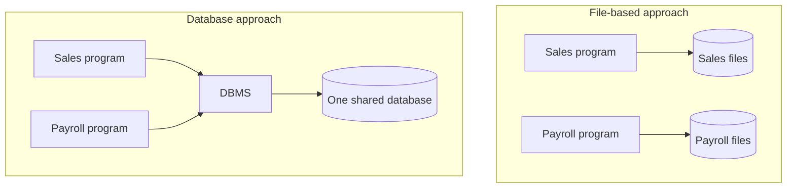

# Lesson 1: Information Systems and Databases

[← Back to index](../README.md) · [Next: The relational model →](02-relational-model.md)

## The big idea

Every organisation needs to keep track of things: students, orders, payments, maps. An **information system** is everything that makes that possible, and a **database** is the part of it that holds the data. This lesson is mostly vocabulary. The words here (DBMS, schema, instance, DDL, DML) are used in every later lesson, so it is worth getting them straight now.

> **Analogy:** a library.
> - The **books** are the data (the database).
> - The **librarian** who stores, finds and protects the books is the DBMS.
> - The **catalogue layout** (title, author, shelf number) is the schema. It rarely changes.
> - The **books currently on the shelves** are the instance. That changes every day.

## 1. What is an information system?

An **information system** is a set of related components that **collect**, **manipulate**, **store** and **disseminate** data and information, and provide a **feedback** mechanism to meet an objective.

| Activity | Meaning | Student system example |
|---|---|---|
| Collect | gather raw data | a student fills in a registration form |
| Manipulate | turn data into useful information | work out a GPA from module grades |
| Store | keep it for later | save the grades |
| Disseminate | produce useful output | print a transcript |
| Feedback | output that is used to change how data is collected or manipulated | a report shows many missing grades, so the form is changed |

Examples from the notes: student management systems, sales order processing systems, geographic information systems and payroll systems.

## 2. Data versus information

- **Data** is raw facts, for example the student number `276545` or the grade `B`.
- **Information** is facts organised so that they are worth more than the facts alone, for example "Mary Smith got a B in Chemistry".
- In a computer system, **information is represented by data**.

## 3. Types of information system

| Type | What it does | Example |
|---|---|---|
| Transaction processing system | handles individual business operations | recording a sale |
| Decision-support system | helps managers decide | where to build a factory |
| Expert (knowledge-based) system | imitates a human expert using a knowledge base | diagnosing why a business failed |
| Office automation system | handles office applications | email, meeting management |

## 4. Components of a computer-based information system

There are seven:

1. **Database (DB)**
2. **Database software**, the database management system (DBMS)
3. **Application software**
4. **Computer hardware**, such as storage media
5. **Network communications**
6. **Personnel** who use and develop the system
7. **Procedures**: the strategies, policies, methods and rules for using it

## 5. DB, DBMS and database system

- A **database (DB)** is a collection of logically related data of interest to the information system.
- A **DBMS** is a software package used to **define, create, use and maintain** a database. MySQL is a DBMS.
- A **database system** is the DBMS and the DB together.

### What a DBMS must handle

A DBMS manages collections of data that are:

| Property | Meaning |
|---|---|
| **Large** | bigger, often much bigger, than the main memory available |
| **Shared** | used by various applications and users |
| **Persistent** | the data outlives any single run of the programs that use it |

While ensuring:

| Property | Meaning |
|---|---|
| **Reliability** | the database is preserved if hardware or software fails |
| **Privacy** | access and authorisations are controlled |

And it must be **efficient** (uses an appropriate amount of time and space) and **effective** (supports the productivity of its users).

✅ A handy way to remember the first five: **L**arge, **S**hared, **P**ersistent, **R**eliable, **P**rivate.

## 6. File-based approach versus database approach

In the **file-based approach**, every application program keeps its data in its own files.

| | File-based approach | Database approach |
|---|---|---|
| Duplicate data | the same facts are stored in several files (**redundancy**) | data is integrated, so redundancy is reduced |
| Consistency | copies can disagree (**inconsistency**) | one copy, so less chance of inconsistency |
| Coupling of programs and data | **strong**: change the file layout and you must change the program | **loose**: programs go through the DBMS |
| Many users at once | concurrency is hard to manage | the DBMS provides concurrency control |
| Joining up departments | hard to integrate applications | the database is a shared resource |
| Querying | each program writes its own | querying and retrieval facilities are provided |

**Why sharing matters:** departments are each interested in part of the data, and those parts overlap. A shared database stores each fact once. Because sharing is never total, the DBMS also provides **privacy** (who may see what) and **concurrency control** (so two users changing the same data don't clash).

## 7. Data models

A **data model** is a set of concepts and constructs used to describe and organise data, its characteristics and its relationships. Two kinds are produced during database design:

| | Conceptual model | Logical model |
|---|---|---|
| When | earlier stages of design | later stages of design |
| What | a high-level description of the data | a translation of the conceptual model towards an implementation |
| Tied to an implementation? | **No**, independent of it | **Yes**, but it still hides physical storage details |
| Most popular | **Entity-Relationship (ER) model** | **Relational model** |

You will meet the relational model in [Lesson 2](02-relational-model.md) and the ER model in [Lesson 11](11-entity-relationship-model.md).

## 8. Schema versus instance

| | Database schema | Database instance |
|---|---|---|
| What it is | the **description** of the data: items, characteristics, relationships, constraints | the **actual data** |
| Over time | invariant (stays the same) | changes |
| Example | `STUDENTS(StudentID, Surname, FirstName, BirthDate)` | the row `(276545, Smith, Mary, 25/11/1990)` |

## 9. Database languages

- **Data definition language (DDL):** defines database **schemas** and access authorisations. Example: `create table`.
- **Data manipulation language (DML):** retrieves and updates database **instances**. Examples: `select`, `insert`.

✅ DDL goes with the schema. DML goes with the instance.

SQL contains both. Database languages come in several forms: interactive text (like SQL), commands embedded in a host language such as C or Java, commands embedded in a purpose-built development language, and graphical interfaces.

## 10. Database users

| User | What they do |
|---|---|
| Information architect | designs the **conceptual** data model from what business users need |
| Database designer | translates the conceptual model into a **logical** model |
| Database administrator | implements and monitors the databases |
| Application developer | writes database applications |
| Business user | runs those applications and queries the databases |

## What to remember

- Information system: collect, manipulate, store, disseminate, plus feedback.
- **Data** is raw facts. **Information** is facts organised to add value.
- **DB** is the data, **DBMS** is the software, **database system** is both.
- A DBMS handles data that is large, shared and persistent, and ensures reliability and privacy.
- The database approach beats files on redundancy, consistency and coupling.
- **Schema** is the description and does not change. **Instance** is the data and does change.
- **DDL** defines schemas. **DML** works on instances.
- Conceptual model (ER) comes first. Logical model (relational) comes second.

---

## Quiz

**Q1.** Name the four activities of an information system, and the fifth mechanism that goes with them.

Show answer

**Collect, manipulate, store, disseminate**, plus a **feedback** mechanism.

**Q2.** A list contains `B`, `C`, `A+`. A report says "Mary Smith passed all three of her exams". Which is data and which is information?

Show answer

The list of grades is **data** (raw facts). The report is **information**, because the facts have been organised to give them extra value.

**Q3.** What is the difference between a DB, a DBMS and a database system?

Show answer

A **DB** is a collection of logically related data. A **DBMS** is the software used to define, create, use and maintain it. A **database system** is the DBMS and the DB together.

**Q4.** A DBMS manages collections of data that are "persistent". What does that mean?

Show answer

The data has a lifespan that is **not limited to a single execution** of the programs that use it. It is still there after the program stops.

**Q5.** True or false: in the file-based approach, applications and data are loosely coupled.

Show answer

**False.** They are **strongly** coupled, because each program stores data in its own dedicated files. Loose coupling is a feature of the database approach.

**Q6.** Give two problems that redundant (duplicate) data causes in the file-based approach.

Show answer

It wastes storage, and it creates a danger of **inconsistent data**: two copies of the same fact can end up with different values.

**Q7.** Is `STUDENTS(StudentID, Surname, FirstName, BirthDate)` a schema or an instance? Does it change over time?

Show answer

It is a **schema**: a description of the data. It is **invariant in time**. The rows stored in the table are the instance, and they change.

**Q8.** Which type of language, DDL or DML, would you use to (a) create a new table, and (b) find all students born in 1990?

Show answer

(a) **DDL**, because it defines the schema. (b) **DML**, because it retrieves data from the instance.

**Q9.** Which data model is used first in database design, and what is the most popular example of it?

Show answer

The **conceptual model** is used in the earlier stages. The most popular is the **Entity-Relationship (ER) model**. The logical model comes later, and its most popular example is the relational model.

**Q10.** Who translates the conceptual data model into a logical data model: the information architect, the database designer or the database administrator?

Show answer

The **database designer**. The information architect designs the conceptual model, and the database administrator implements and monitors the databases.

