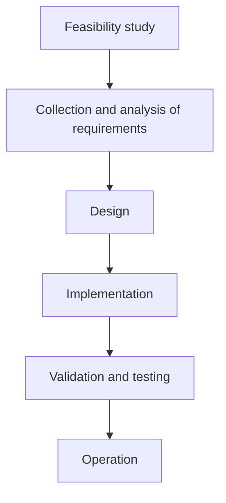
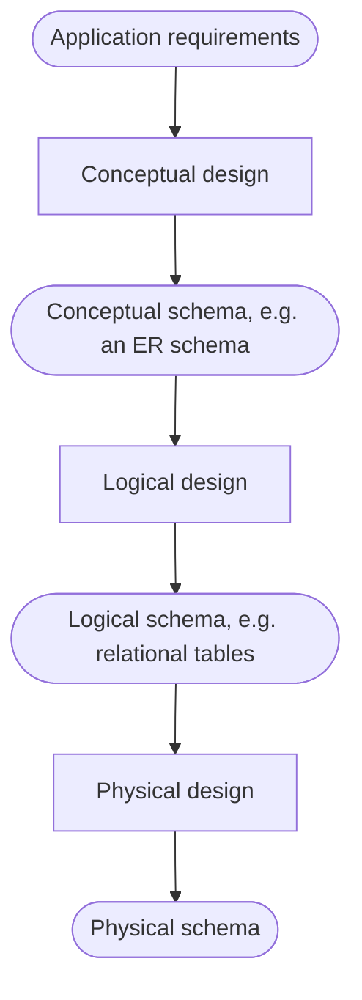

# Lesson 10: Introduction to Database Design

[← Previous: Nested queries and data modification](09-sql-nested-queries-and-data-modification.md) · [Back to index](../README.md) · [Next: The ER model →](11-entity-relationship-model.md)

## The big idea

So far you have been **given** tables and asked to query them. Database design is the other direction: starting from a description in words ("we need to track job adverts, candidates and interviews") and working out **what tables to create**.

**Database design** is the process of defining the **structure, characteristics and contents** of a database according to specified requirements.

The central principle is to **separate "what" from "how"**:

- First decide **what** to represent, without thinking about tables.
- Then decide **how** to represent it in a particular kind of database.

> **Analogy:** building a house. An architect first sketches what the client needs (three bedrooms, a kitchen facing the garden). That sketch works whether the house is built of brick or timber. Only later do the engineers produce construction drawings for one specific building method, and later still decide on wiring and plumbing. Doing these in order means a change of mind early on is cheap.

This is a short lesson. It is the map for lessons 11 to 13.

## 1. Where design fits: the life cycle of an information system

Database design is one activity among many in developing an information system.

| Phase | What happens |
|---|---|
| **Feasibility study** | work out the costs of the possible solutions and set priorities for creating the system's components |
| **Collection and analysis of requirements** | define and study the properties and functionality the system must have |
| **Design** | **database design** (structure, characteristics and contents of the data) and **operational design** (characteristics of the application programs) |
| **Implementation** | create the system according to the design |
| **Validation and testing** | check that the system works correctly and is of good quality |
| **Operation** | manage and maintain the system once it is live |

✅ The Design phase has **two** parts: database design is about the **data**, and operational design is about the **programs**.

## 2. What a design methodology gives you

A structured approach to design consists of:

- a **decomposition** of the design activity into successive, independent **phases**,
- a set of **strategies** for each phase and criteria for making design decisions, and
- **reference models** to describe the inputs and outputs of each phase.

## 3. The three phases of database design

They are followed **consecutively**, in this order.

| Phase | Purpose | Produces | Data model | Depends on the DBMS? |
|---|---|---|---|---|
| **Conceptual design** | represent the informal requirements of the application | a **conceptual schema** | conceptual (the **ER model**) | no |
| **Logical design** | translate the conceptual schema | a **logical schema** | logical (the **relational model**) | on the type of DBMS |
| **Physical design** | complete the logical schema with the details of the physical implementation: **file organisation and indexes** | a **physical schema** | physical | on the specific DBMS |

Linking back to the principle:

- **Conceptual design** answers **"what"**.
- **Logical and physical design** answer **"how"**.

### The same example at each phase

| Phase | What "students sit exams in courses" looks like |
|---|---|
| Requirements | "We must record which students sat which exam and the grade they got." |
| Conceptual schema | an entity STUDENT, an entity COURSE, and a relationship EXAM between them with an attribute Grade |
| Logical schema | `STUDENTS(StudentID, …)`, `COURSES(CourseID, …)`, `EXAMS(StudentID, CourseID, Grade)` |
| Physical schema | the same tables plus decisions such as which indexes to build |

## 4. How the rest of the course maps onto this

| Lesson | Phase |
|---|---|
| [11: The ER model](11-entity-relationship-model.md) | the language used in conceptual design |
| [12: Conceptual design](12-conceptual-design.md) | how to get from requirements to an ER schema |
| [13: Logical design, restructuring](13-logical-design-restructuring.md) | the first step in turning an ER schema into tables |

## What to remember

- Database design defines the **structure, characteristics and contents** of a database.
- Life cycle: **feasibility study, requirements, design, implementation, validation and testing, operation**.
- Design = **database design** + **operational design**.
- Principle: separate **what** to represent from **how** to represent it.
- Three phases, in order: **conceptual, logical, physical**.
- Conceptual → conceptual schema (ER). Logical → logical schema (relational). Physical → physical schema (files and indexes).

---

## Quiz

**Q1.** List the six phases of the life cycle of an information system in order.

Show answer

**Feasibility study**, **collection and analysis of requirements**, **design**, **implementation**, **validation and testing**, **operation**.

**Q2.** The Design phase includes two kinds of design. What are they?

Show answer

**Database design**, which establishes the structure, characteristics and contents of the data, and **operational design**, which defines the characteristics of the application programs.

**Q3.** What is the engineering principle that underlies the database design methodology?

Show answer

Separate the decisions about **what** to represent in the database from the decisions about **how** to do it.

**Q4.** Name the three phases of database design in the order they are carried out.

Show answer

**Conceptual design**, **logical design**, **physical design**.

**Q5.** Which phase produces an ER schema, and which produces a relational schema?

Show answer

**Conceptual design** produces the conceptual schema (an ER schema). **Logical design** produces the logical schema (a relational schema).

**Q6.** In which phase would you decide which indexes to create?

Show answer

**Physical design.** It completes the logical schema with the details of the physical implementation: file organisation and indexes on a given DBMS.

**Q7.** True or false: the logical schema is the input to conceptual design.

Show answer

**False.** It is the other way round. The conceptual schema is produced first and is the input to **logical design**, which produces the logical schema.

**Q8.** In which phase of the information system life cycle is the system checked for correct functioning and quality?

Show answer

**Validation and testing.**

**Q9.** Which phases of database design are concerned with "how" rather than "what"?

Show answer

**Logical design and physical design.** Conceptual design is concerned with what to represent.

