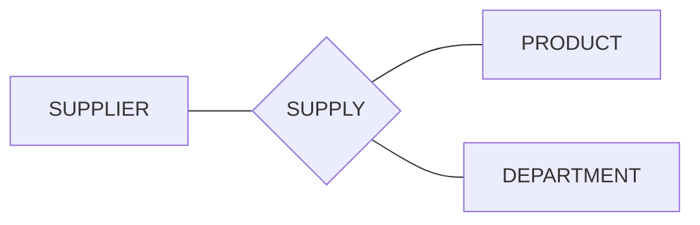
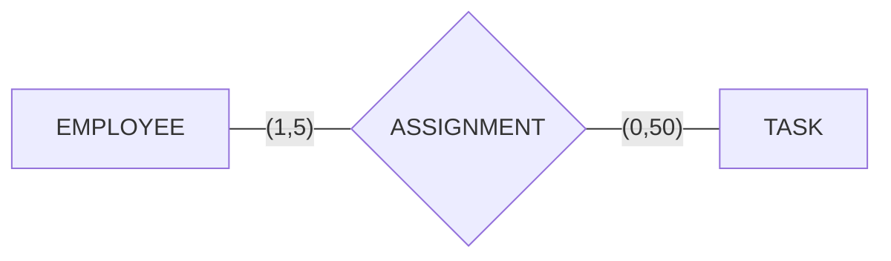
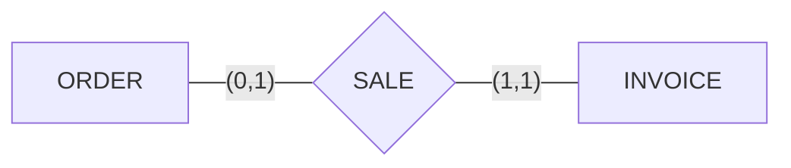
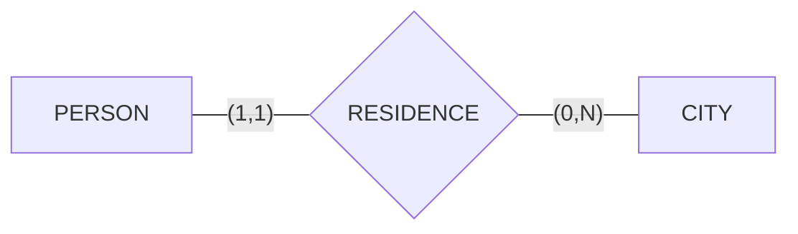
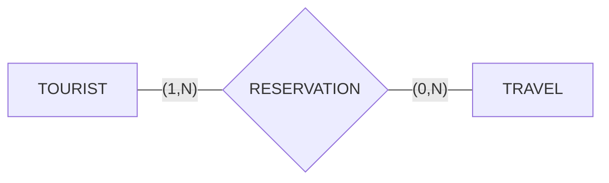
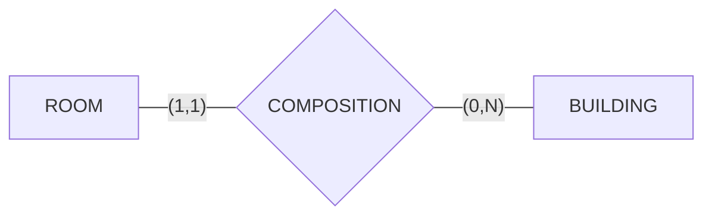
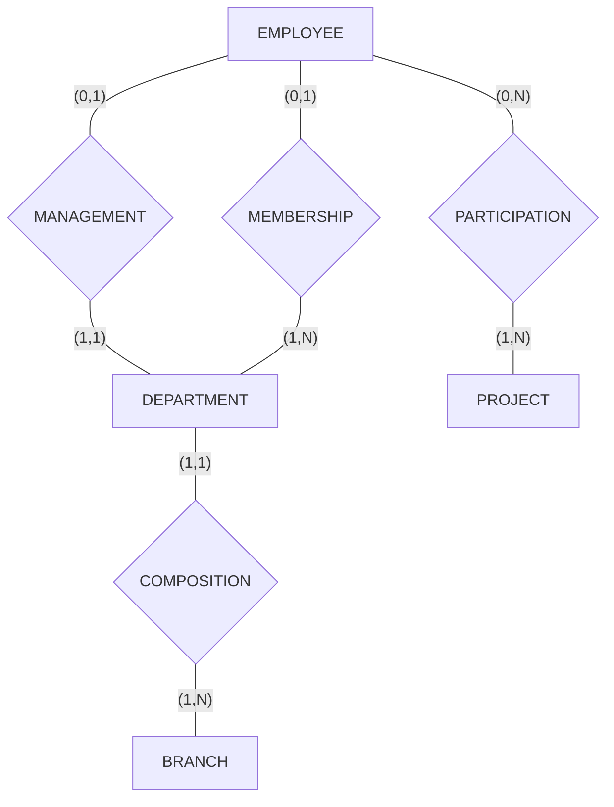
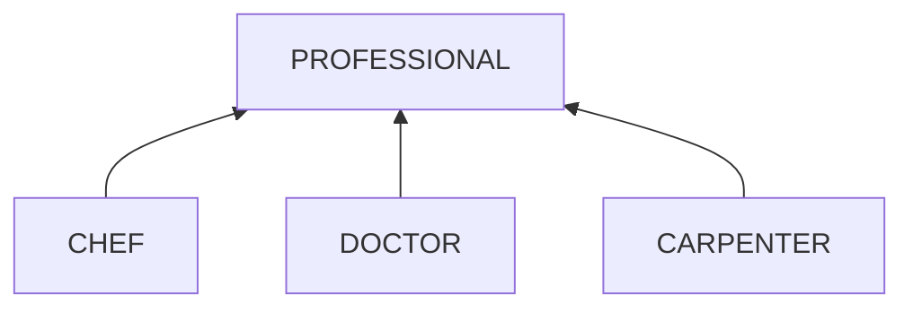

# Lesson 11: The Entity-Relationship (ER) Model

[← Previous: Intro to database design](10-intro-to-database-design.md) · [Back to index](../README.md) · [Next: Conceptual design →](12-conceptual-design.md)

## The big idea

Before creating tables, you draw a picture of **what the database is about**: the things it stores and how they are connected. The **Entity-Relationship (ER) model** is the notation for that picture. It is a **conceptual** data model: easy to understand, and independent of how the data will eventually be managed and organised on the system.

> **Analogy:** a family tree is not the family. It is a diagram that says who exists and how they are related. An ER schema does the same for a database: boxes for the things, diamonds for the links, and numbers for "how many".

## The constructs and their symbols

| Construct | Drawn as |
|---|---|
| **Entity** | a rectangle |
| **Relationship** | a diamond |
| **Attribute** | a line ending in a small **empty** circle |
| **Composite attribute** | an oval with its own attributes hanging off it |
| **Cardinality of a relationship** | a pair (min, max) on the line between entity and relationship |
| **Cardinality of an attribute** | a pair (min, max) on the attribute's line |
| **Internal identifier** | a **filled** circle on one attribute, or a bar joining several attributes that ends in a filled circle |
| **External identifier** | a line ending in a filled circle that passes through an attribute and a relationship |
| **Generalisation** | an arrow from the child entities up to the parent |
| **Subset** | an arrow from a single child up to the parent |

The diagrams in this lesson are drawn with boxes and diamonds, with identifiers listed in text beside them.

## 1. Entities

An **entity** represents a **class of objects** (facts, things, people) that have **properties in common** and an **autonomous existence**.

Examples: STUDENT, COURSE, DEPARTMENT, EMPLOYEE, CITY.

An **occurrence** of an entity is one object of that class. The student Mavis Brown is an occurrence of the entity STUDENT.

✅ Entity = the class. Occurrence = one member of it. (This is the same split as schema and instance.)

## 2. Relationships

A **relationship** represents a **logical link** between two or more entities.

- EXAM is a relationship between STUDENT and COURSE.
- RESIDENCE and WORKPLACE are two different relationships between EMPLOYEE and CITY. Two entities can be linked by more than one relationship.

An **occurrence** of a relationship is an n-tuple made of one occurrence of each entity involved. The pair (Mavis Brown, Physics) is an occurrence of EXAM.

### Special kinds of relationship

**Ternary:** involves more than two entities.

One occurrence of SUPPLY says "this supplier supplies this product to this department".

**Recursive:** links an entity to **itself**.

| Example | Kind | Why |
|---|---|---|
| COLLEAGUE on EMPLOYEE | **symmetrical** | if A is a colleague of B, B is a colleague of A |
| MENTORSHIP on EMPLOYEE, with roles Mentor and Mentee | **asymmetrical** | the two sides play different roles, so each line is labelled with its role |

## 3. Attributes

An **attribute** describes an elementary property of an entity **or a relationship**.

- Surname, Salary and Office are attributes of the entity EMPLOYEE.
- Date and Grade are attributes of the **relationship** EXAM. A grade doesn't belong to the student alone or the course alone. It belongs to the pairing.

Each attribute has a **domain**: the set of admissible values.

**Composite attributes** group attributes with closely connected meanings. For example, Name groups FirstName and Surname, and Address groups Number, Street and PostCode.

## 4. Cardinalities of relationships

Cardinalities are specified **for each entity taking part in a relationship**. They give the **minimum and maximum number of relationship occurrences** in which one occurrence of the entity can participate.

**How to read it.** Take the pair written next to an entity, and make a sentence starting with **one** occurrence of that entity:

- (1,5) next to EMPLOYEE: "**one employee** is assigned between 1 and 5 tasks."
- (0,50) next to TASK: "**one task** is assigned to between 0 and 50 employees."

In most cases three symbols are enough: **0**, **1** and **N** (any integer greater than one).

### What the minimum tells you

| Minimum | Meaning |
|---|---|
| **0** | participation is **optional** |
| **1** | participation is **mandatory** |

### What the maximum tells you

| Maximum | Meaning |
|---|---|
| **1** | each occurrence takes part in **at most one** occurrence of the relationship |
| **N** | each occurrence can take part in **any number** |

### Three examples

An order has zero or one invoice (optional). An invoice belongs to exactly one order (mandatory).

A person lives in exactly one city. A city has any number of residents, possibly none.

A tourist has at least one reservation. A trip can have any number of reservations, possibly none.

### Classifying a binary relationship

Look **only at the two maximum cardinalities**:

| Both maximums | Type | Example |
|---|---|---|
| 1 and 1 | **one-to-one** | SALE between ORDER and INVOICE |
| 1 and N | **one-to-many** | RESIDENCE between PERSON and CITY |
| N and N | **many-to-many** | RESERVATION between TOURIST and TRAVEL |

⚠️ The minimums play no part in this classification.

## 5. Cardinalities of attributes

An attribute can have a cardinality too: the minimum and maximum number of **values** it has for each occurrence.

| Cardinality | Meaning | Example on PERSON |
|---|---|---|
| **(1,1)** | exactly one value. This is the default and is **omitted** from the diagram | PPSN |
| **(0,1)** | optional: the value **can be null** | DrivingLicence |
| **(0,N)** | optional and **multi-valued** | CarRegistration (a person may own no car, or several) |
| **(1,N)** | at least one, possibly several | Phone |

## 6. Identifiers

An **identifier** describes the concepts (attributes and/or entities) that allow the occurrences of an entity to be **unambiguously identified**. It is the ER version of a key.

### Internal identifiers

An **internal identifier** is formed by one or more attributes **of the entity itself**.

| Entity | Identifier | Kind |
|---|---|---|
| VEHICLE(RegistrationNum, Colour, Model) | RegistrationNum | one attribute |
| PERSON(FirstName, Surname, DateOfBirth, Address) | FirstName + Surname + DateOfBirth | several attributes together |

### External identifiers

An **external identifier** involves **other entities**. It is needed when an entity's own attributes are not enough.

- ROOM has attributes RoomNum and Capacity.
- BUILDING has attributes Name (its identifier) and HasElevator.

Room number 101 exists in many buildings, so RoomNum alone does not identify a room. A room is identified by **RoomNum together with the BUILDING it is in**. That is an external identifier.

### Rules for identifiers

- An identifier can use one or more attributes, provided **each has cardinality (1,1)**, that is, not null.
- An external identifier can use one or more entities, provided the entity being identified takes part in the relationship to each of them with cardinality **(1,1)**.
- An external identifier can involve an entity that is itself identified externally, **as long as no cycle is created**.
- **Every entity must have at least one identifier** (internal or external).
- An entity **can have more than one** identifier.

**Why (1,1)?** If a room could be in zero buildings or in two, "the building it is in" would not be a single well-defined thing to identify it by.

**Cyclic identifiers are incorrect.** If E1 is identified using E2 and E2 is identified using E1, neither can ever be identified.

## 7. Worked example: reading a complete schema

| Entity or relationship | Attributes | Identifier |
|---|---|---|
| EMPLOYEE | Code, Name (composite: FirstName, Surname), Salary, DateOfBirth | Code |
| DEPARTMENT | Name, Phone (1,N) | Name **together with BRANCH** (external) |
| PROJECT | Name, Budget, ReleaseDate (0,1) | Name |
| BRANCH | City, Address (composite: Number, Street, PostCode) | City |
| MEMBERSHIP | StartDate | |
| PARTICIPATION | StartDate | |

The lecture asks nine questions about this schema. Here they are with answers.

| # | Question | Answer | Where to look |
|---|---|---|---|
| 1 | What are the attributes of EMPLOYEE? | Code, Name (FirstName and Surname), Salary, DateOfBirth | the attributes attached to EMPLOYEE |
| 2 | How many composite attributes are there? | **Two**: Name (of EMPLOYEE) and Address (of BRANCH) | the ovals |
| 3 | What is the identifier of EMPLOYEE? | **Code** | the filled circle |
| 4 | What is the identifier of DEPARTMENT? | **Name together with BRANCH**, an external identifier through COMPOSITION | department names are only unique within a branch |
| 5 | How many departments can an employee manage? | **Zero or one** | (0,1) next to EMPLOYEE on MANAGEMENT |
| 6 | How many managers can a department have? | **Exactly one** | (1,1) next to DEPARTMENT on MANAGEMENT |
| 7 | Can an employee not participate in any project? | **Yes** | minimum 0 next to EMPLOYEE on PARTICIPATION |
| 8 | Is PARTICIPATION a one-to-many relationship? | **No, it is many-to-many** | both maximums are N |
| 9 | Can ReleaseDate of PROJECT be null? | **Yes** | its cardinality is (0,1) |

## 8. Generalisations

A **generalisation** is a logical link between a **parent** entity E and one or more **child** entities E1…En, where E is more general and includes the children as particular cases.

- E is a **generalisation** of the children.
- The children are **specialisations** of E.

PROFESSIONAL has attributes PPSN and Address. DOCTOR has an extra attribute, Specialisation.

### Two properties

1. Every occurrence of a child entity is **also an occurrence of the parent**. Every doctor is a professional.
2. **Inheritance:** every property of the parent (attributes, identifiers, relationships, other generalisations) is also a property of each child. A DOCTOR has a PPSN and an Address without them being drawn again.

### Classifying generalisations

Ask two separate questions.

**Question 1: is every parent occurrence in some child?**

| Answer | Type | Drawn with | Example |
|---|---|---|---|
| Yes | **total** | a **solid** arrow | STUDENT → FULLTIME, PARTTIME. Every student is one or the other |
| No | **partial** | a hollow arrow | PROFESSIONAL → CHEF, DOCTOR, CARPENTER. There are other professions |

**Question 2: can a parent occurrence be in more than one child?**

| Answer | Type | Example |
|---|---|---|
| No, at most one | **exclusive** | VEHICLE → CAR, TRUCK, MOTORCYCLE |
| Yes | **overlapping** | EMPLOYEE → MANAGER, ENGINEER, TECHNICIAN. An employee could be both a manager and an engineer |

The two answers are independent, so there are four combinations: total and exclusive, total and overlapping, partial and exclusive, partial and overlapping.

### Hierarchies and subsets

- Generalisations can be stacked on several levels to form a **generalisation hierarchy**. Example: USER → REGISTERED_USER, GUEST. Then REGISTERED_USER → STUDENT, INSTRUCTOR, ADMIN.
- A generalisation with a **single child** is called a **subset**. Example: COURSE_ADMIN is a subset of ADMIN.

## 9. Documentation of ER schemas

An ER schema is rarely enough by itself:

- the **names** of concepts may not convey their meaning,
- it may be hard to show **all the attributes** of everything, and
- some properties and constraints **cannot be drawn**, such as Bonus < Salary.

So every schema needs **support documentation**.

### Data dictionary

Two tables, one for entities and one for relationships.

| Entity | Description | Attributes | Identifier |
|---|---|---|---|
| EMPLOYEE | Employee working in the company | Code, Surname, Salary, Age | Code |
| PROJECT | Company project on which employees are working | Name, Budget, ReleaseDate | Name |

| Relationship | Description | Entities involved | Attributes |
|---|---|---|---|
| MANAGEMENT | Associates an employee with a department | Employee (0,1), Department (1,1) | |
| PARTICIPATION | Associates an employee with projects | Employee (0,N), Project (1,N) | StartDate |

⚠️ The lecture slide lists the second entity of PARTICIPATION as "Department (1,N)". That is a slip. In the diagram, PARTICIPATION links EMPLOYEE and **PROJECT**.

### Business rules

Rules that the diagram cannot express.

**Constraints:**
- (BR1) The manager of a department must belong to that department.
- (BR2) A department of the Dublin branch must be managed by an employee with more than 10 years' employment with the company.

**Derivations:**
- (BR5) The budget for a project is obtained by multiplying the sum of the salaries of the employees working on it by 3.

## What to remember

- **Entity** (rectangle): a class of objects with autonomous existence. **Relationship** (diamond): a logical link.
- Attributes can belong to **relationships** as well as entities.
- A cardinality (min, max) is read from **one occurrence of the entity it sits next to**.
- Min 0 = optional. Min 1 = mandatory. Max 1 = at most one. Max N = many.
- Classify one-to-one, one-to-many, many-to-many from the **maximums only**.
- Attribute (0,1) = may be null. Attribute max N = multi-valued. (1,1) is not drawn.
- **Internal** identifier uses the entity's own attributes. **External** identifier also needs another entity, through a (1,1) relationship.
- Every entity needs at least one identifier.
- Generalisation: **total or partial**, and **exclusive or overlapping**. Children **inherit** everything.
- A schema needs a **data dictionary** and **business rules** as well.

---

## Quiz

**Q1.** What is the difference between an entity and an occurrence of an entity?

Show answer

An **entity** is a class of objects with common properties and an autonomous existence, such as STUDENT. An **occurrence** is one object of that class, such as the student Mavis Brown.

**Q2.** Grade is recorded for each exam a student sits in a course. Is Grade best drawn as an attribute of STUDENT, of COURSE, or of the relationship EXAM? Why?

Show answer

Of the **relationship EXAM**. A grade depends on both the student and the course together. A student has many grades (one per course) and a course has many grades (one per student).

**Q3.** In the diagram below, how many tasks can one employee be assigned, and can a task exist with nobody assigned to it?

Show answer

One employee is assigned **between 1 and 5** tasks. **Yes**, a task can have nobody assigned, because the minimum cardinality on the TASK side is 0.

**Q4.** A relationship has cardinalities (1,1) on one side and (0,N) on the other. Is it one-to-one, one-to-many or many-to-many?

Show answer

**One-to-many.** The maximum cardinalities are 1 and N. The minimums don't matter for this classification.

**Q5.** What does a minimum cardinality of 0 say about an entity's participation in a relationship? What about 1?

Show answer

**0** means participation is **optional**. **1** means it is **mandatory**.

**Q6.** PERSON has an attribute CarRegistration with cardinality (0,N). What does that mean?

Show answer

A person can have **no** car registration (the value can be null) or **several**. It is an optional, multi-valued attribute.

**Q7.** Why does ROOM need an external identifier in the ROOM / BUILDING example?

Show answer

RoomNum is not enough on its own, because the same room number can occur in different buildings. A room is identified by RoomNum **together with the BUILDING** it belongs to.

**Q8.** What cardinality must an entity have in a relationship for that relationship to be used in its external identifier?

Show answer

**(1,1).** The entity being identified must be linked to exactly one occurrence of the other entity.

**Q9.** In the complete schema of section 7, can a department belong to more than one branch? Can a branch have no departments?

Show answer

**No** to both. DEPARTMENT takes part in COMPOSITION with (1,1), so each department belongs to exactly one branch. BRANCH takes part with (1,N), so each branch has at least one department.

**Q10.** In the same schema, can an employee belong to no department?

Show answer

**Yes.** EMPLOYEE takes part in MEMBERSHIP with cardinality (0,1): zero or one department.

**Q11.** STUDENT is the parent of FULLTIME and PARTTIME. Every student is exactly one of the two. Classify the generalisation.

Show answer

**Total** (every student is in one of the children) and **exclusive** (no student is in both).

**Q12.** EMPLOYEE is the parent of MANAGER, ENGINEER and TECHNICIAN. Some employees are none of these, and some are both a manager and an engineer. Classify the generalisation.

Show answer

**Partial** (some employees are in no child) and **overlapping** (an employee can be in more than one child).

**Q13.** PROFESSIONAL has attributes PPSN and Address. DOCTOR is a child of PROFESSIONAL with one attribute of its own, Specialisation. What attributes does a doctor have?

Show answer

**PPSN, Address and Specialisation.** The child inherits every property of the parent.

**Q14.** What is a subset?

Show answer

A generalisation with a **single child** entity.

**Q15.** "Bonus must be less than Salary." Can this be shown in an ER diagram? If not, where is it recorded?

Show answer

**No.** It cannot be expressed directly by the constructs of the model. It is recorded in the **support documentation** as a business rule (a constraint).

