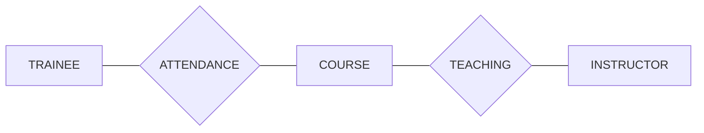
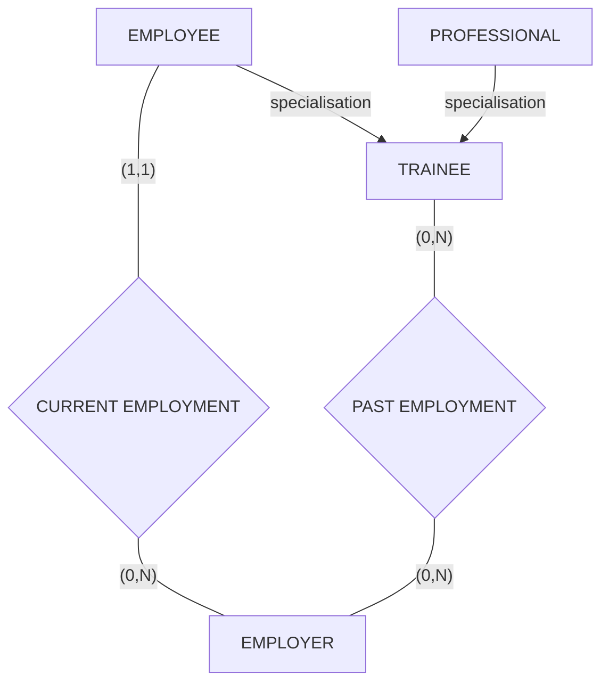
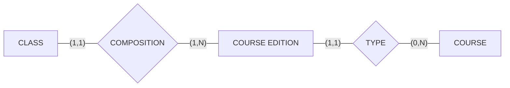
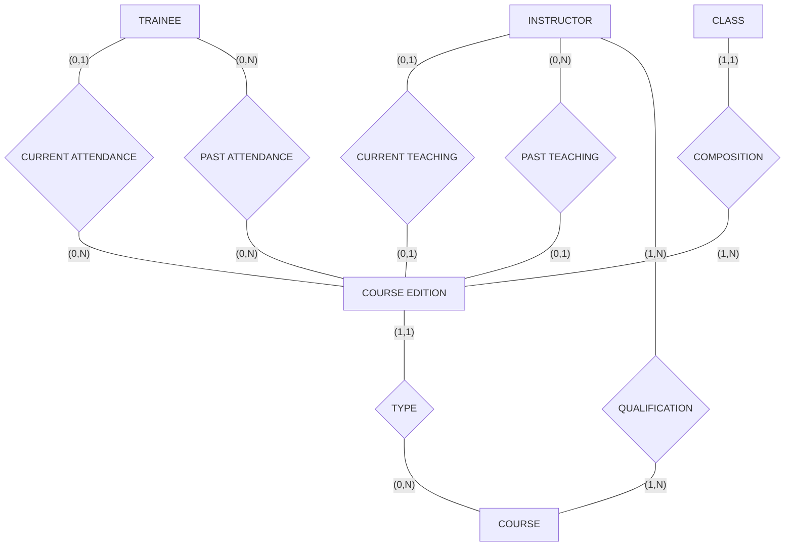

# Lesson 12: Conceptual Design

[← Previous: The ER model](11-entity-relationship-model.md) · [Back to index](../README.md) · [Next: Logical design, restructuring →](13-logical-design-restructuring.md)

## The big idea

[Lesson 11](11-entity-relationship-model.md) taught you to **read** ER schemas. This lesson is about **producing** one from a description written in ordinary language.

The **conceptual design** of a database is the construction of an **ER schema** that gives an optimal description of the application requirements.

It happens in three stages:

1. **Collect and analyse** the requirements, cleaning up the wording.
2. **Translate** each concept into an ER construct, using four criteria.
3. **Build** the schema: start with a skeleton, refine it part by part, then integrate.

> **Analogy:** a client describes their dream house in a rambling email. Before drawing anything, the architect rewrites it as a clear list, checks what the vague parts mean, and notices that "the den", "the study" and "my office" are all the same room. Only then does the drawing start, beginning with a rough outline and adding detail room by room.

This lesson follows the lecture's single running example, a **training company**, from start to finish.

## 1. Requirements collection and analysis

- Requirements are **collected** by identifying the problems the application must solve and the features that characterise it.
- Requirements are **analysed** by clarifying and organising the requirement specification.
- The two activities are closely related and happen together.

### Where requirements come from

- **Application users**
- **Existing documentation** connected to the problem: forms, internal rules, business procedures, laws, regulations
- **Earlier applications** that are to be replaced, or that must interact with the new one

Requirements are usually written in **natural language**, which is open to **ambiguity and misinterpretation**. They must be analysed in depth to remove inaccuracies and ambiguities.

### The example specification

> We wish to create a database for a company that runs training courses. For this, we must store data about the trainees and the instructors. For each course participant (about 5000), identified by a code, we want to store the social security number, surname, age, sex, place of birth, employer's name, address and telephone number, previous employers (and period employed), the courses attended (there are about 200 courses) and the final assessment of each course. We need also to represent the seminars that each participant is attending at present and, for each day, the places and times the classes are held. Each course has a code and a title and any course can be given any number of times. Each time a particular course is given, we will call it an 'edition' of the course. For each edition, we represent the start date, the end date, and the number of participants. If a trainee is a self-employed professional, we need to know his or her area of expertise, and, if appropriate, his or her title. For somebody who works for a company, we store the level and position held. For each instructor (about 300), we will show the surname, age, place of birth, the edition of the course taught, those taught in the past and the courses that the tutor is qualified to teach. All the instructors' telephone numbers are also stored. An instructor can be permanently employed by the training company or can be freelance.

It reads fine at first glance, but it is full of problems. The six rules below find them.

## 2. Six rules for analysing requirements

| # | Rule | What it fixes |
|---|---|---|
| 1 | Choose the appropriate **level of abstraction** | terms that are too vague or too detailed |
| 2 | **Standardise sentence structure** | sentences written in many different styles |
| 3 | **Avoid complex phrases** | long, tangled sentences |
| 4 | Identify **synonyms and homonyms**, and standardise terms | several words for one thing, or one word for several things |
| 5 | Make **cross-references explicit** | phrases where it is unclear what a detail belongs to |
| 6 | Construct a **glossary of terms** | no shared definition of the vocabulary |

### Applying them to the example

**Rule 1, level of abstraction.** Two phrases are too vague:
- "period employed" → does that mean a **start date and an end date**?
- "final assessment" → is that **marks out of ten**?

**Rule 2, standardise sentence structure.** Rewrite everything in one pattern, "For each … we hold …":
- "For each trainee (about 5000), identified by a code, we hold their social security number, surname, …"
- "For each instructor (about 300), we hold their surname, age, …"

**Rule 4, synonyms and homonyms.**
- A **synonym** is two different words for the **same** concept.
- A **homonym** is the same word used for **different** concepts.

The text uses several words for one thing:

| Words in the text | Standard term chosen |
|---|---|
| course participant, participant, trainee | **Trainee** |
| instructor, tutor | **Instructor** |
| course, seminar | **Course** |

It also contains a homonym: "place" means a **town** in "place of birth", but a **classroom** in "the places … the classes are held".

**Rule 5, cross-references.** "…employer's name, address and telephone number…": are the address and telephone number those of the **trainee** or of the **employer**? The sentence does not say. It must be made explicit. (They are the employer's.)

**Rule 6, the glossary.**

| Term | Description | Synonym | Links |
|---|---|---|---|
| Trainee | Participant in a course. Can be an employee or self-employed. | Participant | Course, Employer |
| Instructor | Course tutor. Can be freelance. | Tutor | Course |
| Course | Course offered. Can have various editions. | Seminar | Instructor, Trainee |
| Employer | Company by which a trainee is employed or has been employed. | | Trainee |

### The result: grouped, standardised phrases

After analysis, the specification is rewritten as groups of sentences, one group per concept:

- **Phrases relating to the trainees.** For each trainee (about 5000), identified by a code, we will hold the social security number, surname, age, sex, town of birth, current employer, previous employers (along with the start date and the end date of the period employed), the editions of the courses the trainee is attending at present and those he or she has attended in the past, with the final marks out of ten.
- **Phrases relating to the employers of the trainees.** For each employer of a trainee we will hold the name, address and telephone number.
- **Phrases relating to the courses.** For each course (about 200), we will hold the name and code. Each time a particular course is given, we will call it an 'edition' of the course. For each edition, we will hold the start date, the end date, and the number of participants. For the editions currently in progress, we will hold the dates, the classrooms and the times in which the classes are held.

Notice how every ambiguity found above has been resolved in this version.

## 3. Four criteria for choosing a construct

Once the requirements are clean, each concept is translated into an ER construct.

| If the concept… | Represent it as | Example |
|---|---|---|
| has **significant properties** and/or describes a class of objects with an **autonomous existence** | an **entity** | Trainee, Instructor, Course, Employer |
| has a **simple structure** and **no relevant properties** of its own | an **attribute** of the concept it refers to | Age, Surname, TownOfBirth |
| provides a **logical link** between two or more entities | a **relationship** | Attendance (a trainee attends a course) |
| is a **particular case** of another concept | a **generalisation** | Employee and Professional are particular cases of Trainee |

### The entity-or-attribute test

Ask: **do we need to store anything about it?**

- **Town of birth:** we store only its name. Nothing else about the town matters. → **attribute**.
- **Employer:** we store its name, address and telephone number. It has properties of its own. → **entity**.

The same real-world thing can be an attribute in one application and an entity in another. It depends on the requirements, not on the thing.

## 4. Building the schema step by step

### Step 1: the skeleton schema

Define a **skeleton schema** containing only the principal concepts, at an abstract level.

Three entities and two relationships. No attributes, no cardinalities yet.

### Step 2: refine the part about trainees

- Create two specialisations of TRAINEE: **EMPLOYEE** and **PROFESSIONAL**.
- Represent the **employers** of the trainees with a new entity, EMPLOYER.
- Represent **past and present** employment with two relationships.
- Add attributes, identifiers and cardinalities.

| Element | Attributes |
|---|---|
| TRAINEE | **Code** (identifier), SSN (also an identifier), Surname, Sex, Age, TownOfBirth |
| EMPLOYEE | Position, Level |
| PROFESSIONAL | Expertise, ProfessionalTitle (0,1) |
| EMPLOYER | **Name** (identifier), Address, Phone |
| CURRENT EMPLOYMENT | StartDate |
| PAST EMPLOYMENT | StartDate, EndDate |

Why these choices:
- "If a trainee is a self-employed professional… For somebody who works for a company…" describes **particular cases** of a trainee, so it becomes a generalisation.
- ProfessionalTitle is (0,1) because the text says "if appropriate". It may be missing.
- An employee has exactly one current employer, hence (1,1).

### Step 3: refine the part about instructors

- Create two specialisations of INSTRUCTOR: **FREELANCE** and **PERMANENT**.
- Add attributes and identifiers: **SSN** (identifier), Surname, Age, TownOfBirth, Phone (1,N).

Phone is (1,N) because the text says "**All** the instructors' telephone numbers are also stored". An instructor can have several.

### Step 4: refine the part about courses

- Distinguish two concepts, **COURSE** and **COURSE EDITION**, and link them with a relationship.
- Add an entity **CLASS** and its relationship with COURSE EDITION.
- Add attributes, cardinalities and identifiers.

| Entity | Attributes | Identifier |
|---|---|---|
| COURSE | Name, Code | Code |
| COURSE EDITION | StartDate, EndDate, NoOfPart | StartDate **together with COURSE** (external) |
| CLASS | Time, Room, Date | Time + Room + Date |

**Why split COURSE from COURSE EDITION?** "Databases" is a course. "Databases, starting 14 September" is one edition of it. The name and code belong to the course. The dates and the number of participants belong to an edition. One course has many editions.

⚠️ The lecture slide says "relationship with CourseCondition" here. That is a typo for **CourseEdition**.

### Step 5: integrate

Combine the refined parts into the final ER schema. The skeleton's two relationships are each split into a **current** and a **past** version, because the requirements treat them differently.

(The trainee and instructor generalisations and the employment relationships from steps 2 and 3 are also part of the final schema. They are left out of this drawing to keep it readable.)

Details worth noticing:
- **PAST ATTENDANCE** has an attribute **Marks**. The final mark exists only once the edition is over.
- A trainee attends **at most one** edition at present: (0,1) on CURRENT ATTENDANCE.
- **QUALIFICATION** links INSTRUCTOR straight to COURSE, not to an edition. An instructor is qualified to teach a course in general.

## 5. Properties of a good conceptual schema

| Property | Meaning |
|---|---|
| **Correctness** | the constructs of the conceptual model are **used correctly** |
| **Completeness** | the schema represents **all** the data requirements and allows all the specified operations to be executed |
| **Readability** | the requirements are represented in a way that is **natural and easy to understand** |
| **Minimality** | every specification on the data is represented **only once** in the schema |

On minimality: **redundancies are not always undesirable**, but when they appear they must be **carefully justified**. [Lesson 13](13-logical-design-restructuring.md) looks at when to keep one.

## What to remember

- Conceptual design = building an **ER schema** from the application requirements.
- Requirements come from **users, existing documentation and earlier applications**, usually in ambiguous natural language.
- Six analysis rules: **abstraction level, sentence structure, no complex phrases, synonyms and homonyms, cross-references, glossary**.
- **Synonym:** different words, same concept. **Homonym:** same word, different concepts.
- Four criteria: properties or autonomous existence → **entity**. Simple, no properties → **attribute**. Logical link → **relationship**. Particular case → **generalisation**.
- Method: **skeleton schema, refine each part, integrate**.
- A good schema is **correct, complete, readable and minimal**.

---

## Quiz

**Q1.** What does the conceptual design of a database produce?

Show answer

An **ER schema** that provides an optimal description of the application requirements.

**Q2.** Name three sources of application requirements.

Show answer

**Application users**, **existing documentation** (forms, internal rules, business procedures, laws, regulations), and **earlier applications** that are to be replaced or that must interact with the new one.

**Q3.** Why must requirements written in natural language be analysed in depth?

Show answer

Natural language is subject to **ambiguity and misinterpretation**. Analysis removes the inaccuracies and ambiguities.

**Q4.** In the training company text, "course participant", "participant" and "trainee" all appear. What is this an example of, and what do you do about it?

Show answer

**Synonyms**: different words for the same concept. Choose one standard term (Trainee) and use it everywhere.

**Q5.** What is a homonym? Give the example from the training company text.

Show answer

The **same word used for different concepts**. "Place" means a town in "place of birth" and a classroom in "the places … the classes are held".

**Q6.** "…employer's name, address and telephone number…" Which of the six rules does this phrase break, and why?

Show answer

**Make cross-references explicit.** It is not clear whether the address and telephone number belong to the trainee or to the employer.

**Q7.** Which construct should each of these become?
(a) a concept with a simple structure and no relevant properties
(b) a concept that is a particular case of another
(c) a concept that links two entities

Show answer

(a) an **attribute**. (b) a child in a **generalisation**. (c) a **relationship**.

**Q8.** A library records, for each book, its publisher's name only. A second library records each publisher's name, address and contact person. How should "publisher" be represented in each?

Show answer

In the first, as an **attribute** of BOOK: it has a simple structure and no relevant properties. In the second, as an **entity**: it has significant properties of its own.

**Q9.** What is a skeleton schema?

Show answer

A first schema that contains only the **principal concepts** of the application at an abstract level. It is then refined and integrated into the final schema.

**Q10.** Why is COURSE EDITION a separate entity from COURSE in the training company schema?

Show answer

A course can be given any number of times, and each time is an edition with its **own** start date, end date and number of participants. Those properties belong to the edition, not to the course, whose properties are its name and code.

**Q11.** In the training company schema, PROFESSIONAL has an attribute ProfessionalTitle with cardinality (0,1). Which words in the requirements justify that?

Show answer

"…and, **if appropriate**, his or her title." The title may not exist, so the minimum cardinality is 0.

**Q12.** List the four properties of a good conceptual schema.

Show answer

**Correctness, completeness, readability, minimality.**

**Q13.** A schema stores every requirement, but stores the number of participants of a course edition twice in two different places. Which property does it fail?

Show answer

**Minimality.** A schema is minimal if every specification on the data is represented only once. (A redundancy can be kept, but only if it is carefully justified.)

