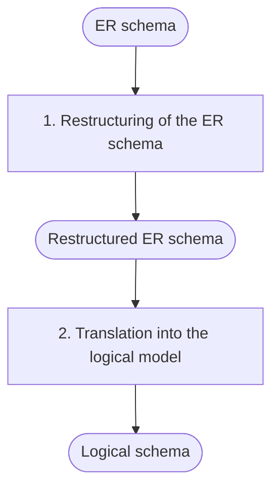
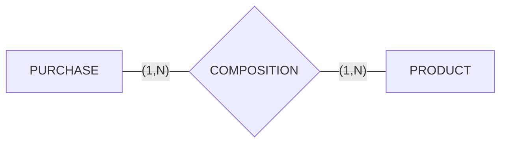
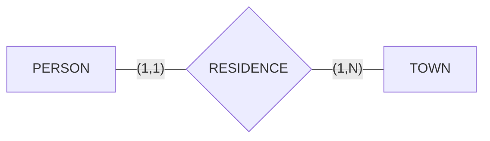
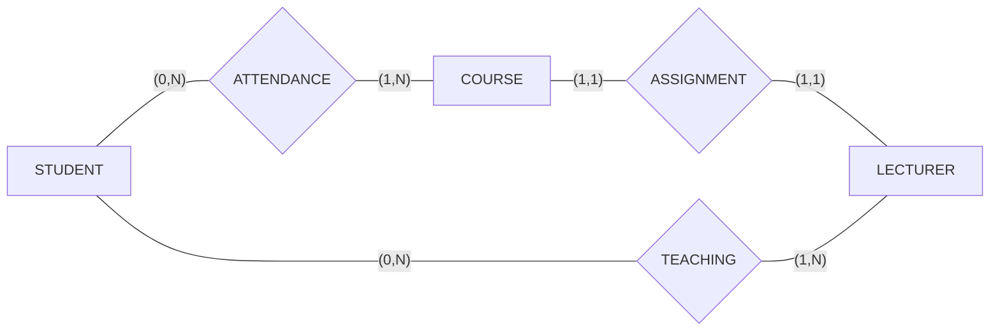

# Lesson 13: Logical Design Part 1, Restructuring ER Schemas

[← Previous: Conceptual design](12-conceptual-design.md) · [Back to index](../README.md)

## The big idea

You now have an ER schema. The goal is tables. **Logical design** builds a logical schema (a relational schema) that **correctly and efficiently** represents the information in the conceptual schema.

It is **not a simple translation**, for two reasons:

1. **Not every ER construct has a natural equivalent in the relational model.** A table cannot directly hold a generalisation or a multi-valued attribute.
2. **Performance now matters.** Conceptual design ignored how the data will be used. Logical design must consider the operations that will be run.

So logical design has two steps:

This lesson covers **step 1, restructuring**: reshaping the ER schema so that everything left in it can be turned into tables.

> **Analogy:** flat-pack furniture. The designer's sketch may have a beautiful curved shelf. Before it can be manufactured, it has to be redrawn using only the flat panels the factory can cut. Restructuring is that redraw: the same piece of furniture, expressed with simpler parts.

## The four restructuring tasks

They are done in this order:

| # | Task | Question it answers |
|---|---|---|
| 1 | **Analysis of redundancies** | Is any information stored that could be worked out from other data? Keep it or remove it? |
| 2 | **Removing generalisations** | How do we replace parent and child entities with ordinary entities and relationships? |
| 3 | **Partitioning/merging of entities and relationships** | Should anything be split up or joined together to make operations more efficient? |
| 4 | **Selection of primary identifiers** | Where an entity has several identifiers, which one becomes the primary key? |

## 1. Analysis of redundancies

A **redundancy** is a piece of information that **can be derived from other data**.

### Four forms it can take

**An attribute derivable from other attributes of the same entity.**
INVOICE has NetAmount, Tax and GrossAmount. GrossAmount = NetAmount + Tax, so one of the three is redundant.

**An attribute derivable from attributes of another entity.**

PURCHASE has TotalAmount. PRODUCT has Price. TotalAmount can be found by adding up the prices of the products in the purchase.

**An attribute derivable by counting occurrences.**

TOWN has NumberOfInhabitants. That number can be found by counting the persons linked to the town through RESIDENCE.

**A relationship derivable from other relationships** (a cycle).

TEACHING links students directly to lecturers. But you can already find a student's lecturers by going from STUDENT through ATTENDANCE to COURSE and through ASSIGNMENT to LECTURER. TEACHING is redundant.

### Keep it or remove it?

Generally, redundancies are undesirable. But some offer benefits.

| | Effect of keeping a redundancy |
|---|---|
| ❌ Disadvantage | more **storage** is needed |
| ❌ Disadvantage | **extra operations** are needed to keep the data consistent (every new resident means updating NumberOfInhabitants) |
| ✅ Advantage | it can reduce **data access costs** (reading one stored number is faster than counting thousands of rows) |

**The decision** is made by weighing the **cost of the operations** that involve the redundant information against the **storage** needed.

**Rule of thumb (my summary of that criterion).** If the value is **read often and changed rarely**, keep the redundancy. If it is **changed often and read rarely**, remove it.

## 2. Removing generalisations

**All generalisations must be removed** before translation, because the relational model has no direct way to represent them. They are transformed into other constructs: entities and relationships.

### The method shown in the lecture: merge the children into the parent

**Before:** parent E0 with attributes A01 and A02. Children E1 (attribute A11) and E2 (attribute A21). E2 takes part in a relationship R2 with cardinality (X,Y).

**After:** a single entity E0.

Three things are done:

1. **Merge the child entities into the parent.** Their attributes and relationships move up to E0.
2. **Introduce a new attribute, Atype**, to record which kind of entity each occurrence is (E1 or E2).
3. **Adjust the cardinalities.**
   - The children's attributes A11 and A21 become **(0,1)**. An occurrence that was an E1 has no value for A21, so it must be allowed to be null.
   - The relationship R2 gets a minimum of **0**: (X,Y) becomes **(0,Y)**. Occurrences that were not E2 do not take part in it.

**Example.** PERSON is the parent of STUDENT (attribute StudentNumber) and LECTURER (attribute Office).

| | Before | After |
|---|---|---|
| Entities | PERSON, STUDENT, LECTURER | PERSON only |
| Attributes of PERSON | PPSN, Name | PPSN, Name, **Type**, StudentNumber **(0,1)**, Office **(0,1)** |

A student row has Type = "student", a StudentNumber, and a null Office.

**Beyond the notes:** this lecture shows only the merge-into-the-parent method. The complete example at the end of the lecture removes the TRAINEE generalisation differently, by keeping the children as separate entities linked to the parent through (1,1) relationships. Translation into tables is covered in part 2 of logical design.

## 3. Partitioning and merging

Entities and relationships can be split or combined to make operations more efficient. Four principles:

- Attributes of the **same concept** that are accessed by **different operations** should be **separated**.
- Attributes of **different concepts** that are accessed by the **same operations** should be **merged**.
- **Multi-valued attributes must be removed.**
- The criteria used for redundancies (cost of operations, storage) apply here too.

### Partitioning an entity

*Assumption: employment data and personal data of employees are often accessed separately by different operations.*

| | Entities |
|---|---|
| Before | EMPLOYEE(**EmployeeNumber**, NextOfKin, HomeAddress, DateOfBirth, Office, Salary, Tax) |
| After | PERSONAL DATA(**EmployeeNumber**, NextOfKin, HomeAddress, DateOfBirth) and EMPLOYMENT DATA(Office, Salary, Tax), linked by a relationship EMPLOYEE DATA with cardinality **(1,1) on both sides** |

EMPLOYMENT DATA has no identifier of its own, so it is identified **externally** through the relationship.

### Merging entities

*Assumption: the personal information of a person and the details of the apartment they own are often accessed together.*

| | Entities |
|---|---|
| Before | PERSON(**PPSN**, Name, Address, Age) —(0,1)— OWNER —(1,1)— APARTMENT(AptNumber, AptAddress) |
| After | PERSON(**PPSN**, Name, Address, Age, AptNumber **(0,1)**, AptAddress **(0,1)**) |

The apartment attributes become **(0,1)** because a person may own no apartment. That was the (0,1) on the PERSON side of OWNER.

### Removing a multi-valued attribute

This one is **mandatory**, not an optimisation. A table cell holds one value, so an attribute with maximum cardinality N cannot be stored directly.

| | Entities |
|---|---|
| Before | AGENCY(**Name**, Address, Town, Telephone **(1,N)**) |
| After | AGENCY(**Name**, Address, Town) —(1,N)— HOLDER —(1,1)— TELEPHONE(**Number**) |

The attribute becomes its **own entity**, linked back by a relationship. Notice that the attribute's cardinality (1,N) became the cardinality on the AGENCY side: an agency holds one or more telephones. Each telephone belongs to exactly one agency.

### Partitioning a relationship

*Assumption: information about current players is often accessed separately from information about past players.*

| | Relationships between PLAYER and TEAM |
|---|---|
| Before | COMPOSITION, (1,N) on both sides, with attributes DateJoined and DateLeft (0,1) |
| After | **PRESENT COMPOSITION** with DateJoined, cardinality (0,1) for PLAYER and (0,N) for TEAM. **PAST COMPOSITION** with DateJoined and DateLeft, cardinality (0,N) on both sides |

Things to notice:
- DateLeft was (0,1) because a current player has not left yet. After the split it is only on PAST COMPOSITION, where it always has a value.
- A player is currently in **at most one** team, hence (0,1) on PRESENT COMPOSITION.

## 4. Selection of primary identifiers

An entity can have several identifiers. One must be chosen as the **primary identifier**, which will become the primary key of its table.

Criteria:

- Attributes with **null values cannot** form identifiers.
- **One or few** attributes are preferable to many.
- An **internal** identifier with few attributes is preferable to an **external** one, which may involve many entities.
- An identifier that is **used by many operations** to access the occurrences of the entity is preferable.

**If no candidate is suitable,** add a new attribute to the entity. It holds special values, often called **codes**, generated solely to identify occurrences.

**Example.** PERSON can be identified by PPSN, or by FirstName + Surname + DateOfBirth. Choose **PPSN**: it is one attribute, not three.

## 5. Complete example: the training company

Here is what restructuring did to the schema built in [Lesson 12](12-conceptual-design.md).

| Change | Task | Before | After |
|---|---|---|---|
| Instructor phone numbers | removing a multi-valued attribute | INSTRUCTOR has Phone (1,N) | new entity **TELEPHONE**(Number), linked to INSTRUCTOR by **HOLDER** |
| Instructor types | removing a generalisation | FREELANCE and PERMANENT are children of INSTRUCTOR | children merged into INSTRUCTOR, with a new attribute **Type** |
| Trainee types | removing a generalisation | EMPLOYEE and PROFESSIONAL are children of TRAINEE | EMPLOYEE and PROFESSIONAL kept as entities, linked to TRAINEE by relationships **EMPLOYMENT DATA** and **PROFESSIONAL DATA** |
| Attendance | merging relationships | CURRENT ATTENDANCE and PAST ATTENDANCE (with Marks) | one relationship **ATTENDANCE**, with Marks **(0,1)** |
| Teaching | merging relationships | CURRENT TEACHING and PAST TEACHING | one relationship **TEACHING** |
| Number of participants | removing a redundancy | COURSE EDITION has NoOfPart | NoOfPart removed. It can be found by counting attendances |
| Course edition | selecting a primary identifier | identified by StartDate together with COURSE | a new attribute **Code** is added as the identifier |

Marks becomes (0,1) after the merge because a trainee who is still attending has no mark yet.

Why merge FREELANCE and PERMANENT into the parent, but keep EMPLOYEE and PROFESSIONAL separate? The instructor children have **no attributes or relationships of their own**, so a single Type attribute captures the whole difference. The trainee children **do** have their own attributes (Position and Level, ProfessionalTitle and Expertise), and EMPLOYEE has its own relationship to EMPLOYER.

## What to remember

- Logical design = **restructuring** + **translation**. It is not a simple translation.
- Four restructuring tasks: **redundancies, generalisations, partitioning/merging, primary identifiers**.
- A **redundancy** is information derivable from other data. It costs storage and upkeep, but can speed up access.
- **Generalisations must be removed.** Merge children into the parent, add a **type** attribute, and loosen cardinalities to allow nulls.
- Split what is accessed **separately**. Merge what is accessed **together**.
- **Multi-valued attributes must be removed**, by turning them into an entity and a relationship.
- Primary identifier: **no nulls, few attributes, internal over external, heavily used**. If nothing fits, add a **code**.

---

## Quiz

**Q1.** What are the two main steps of logical design?

Show answer

**Restructuring of the ER schema**, then **translation into the logical model**.

**Q2.** Give two reasons why logical design is "not a simple translation".

Show answer

**Not all constructs** of the ER model can be translated naturally into constructs of the relational model, and **aspects such as the performance** of the operations, which were not considered in conceptual design, must now be taken into account.

**Q3.** List the four tasks of the restructuring step in order.

Show answer

**Analysis of redundancies**, **removing generalisations**, **partitioning/merging of entities and relationships**, **selection of primary identifiers**.

**Q4.** What is a redundancy? Give an example.

Show answer

A piece of information that **can be derived from other data**. Examples: GrossAmount in INVOICE (derivable from NetAmount and Tax), or NumberOfInhabitants in TOWN (derivable by counting the persons who reside there).

**Q5.** Give one disadvantage and one advantage of keeping a redundancy.

Show answer

Disadvantage: it **increases storage** and requires **additional operations** to keep the data consistent. Advantage: it can **reduce data access costs**.

**Q6.** TOWN stores NumberOfInhabitants. The number is displayed thousands of times a day, and people move town rarely. Keep the redundancy or remove it?

Show answer

**Keep it.** It is read very often and updated rarely, so the saving in access cost outweighs the small cost of keeping it up to date.

**Q7.** Why must all generalisations be removed before translating to the relational model?

Show answer

Because the relational model **does not allow direct representation** of generalisations.

**Q8.** VEHICLE (Registration, Model) is the parent of CAR (attribute NumDoors) and TRUCK (attribute LoadCapacity). The children are merged into the parent. What attributes does VEHICLE have afterwards, and with what cardinalities?

Show answer

Registration, Model, a new attribute **Type** (car or truck), **NumDoors (0,1)** and **LoadCapacity (0,1)**.

The children's attributes become optional, because a car has no load capacity and a truck has no number of doors recorded.

**Q9.** In Q8, TRUCK took part in a relationship with cardinality (1,N). What is the cardinality after merging?

Show answer

**(0,N).** The minimum becomes 0, because vehicles that are not trucks do not take part in that relationship.

**Q10.** CUSTOMER has an attribute Email with cardinality (1,N). Why can't this be left as it is, and how is it restructured?

Show answer

It is a **multi-valued attribute**, and these must be removed. Create a new entity EMAIL with an attribute Address, and link it to CUSTOMER with a relationship: (1,N) on the CUSTOMER side and (1,1) on the EMAIL side.

**Q11.** An entity has twelve attributes. Six are used by the payroll system and six by the security desk, and the two never need each other's data. Which restructuring is appropriate?

Show answer

**Partitioning** the entity. Attributes of the same concept that are accessed by different operations should be separated.

**Q12.** BOOK can be identified by ISBN, or by Title + Author + Edition. Which should be the primary identifier, and why?

Show answer

**ISBN.** One attribute is preferable to several.

**Q13.** An entity's only identifier includes an attribute that can be null. What do you do?

Show answer

Attributes with null values cannot form identifiers. **Introduce a new attribute** (a code) generated solely for the purpose of identifying occurrences of the entity.

**Q14.** In the restructured training company schema, why does Marks have cardinality (0,1) on ATTENDANCE?

Show answer

ATTENDANCE now covers both current and past attendance. A trainee who is still attending an edition has **no final mark yet**, so the attribute must be optional.

