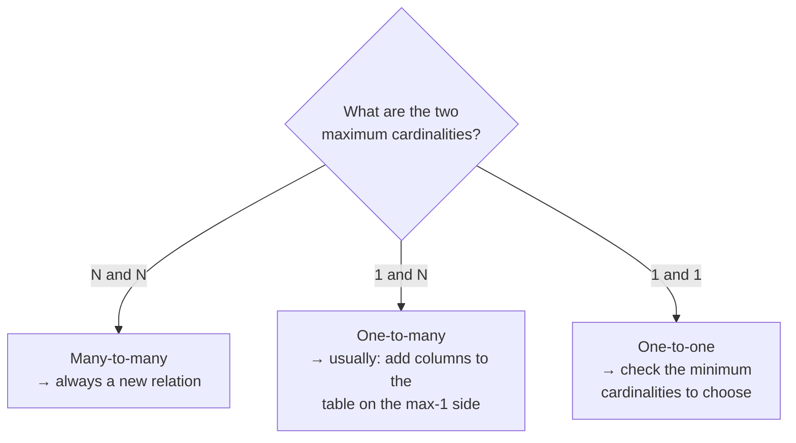
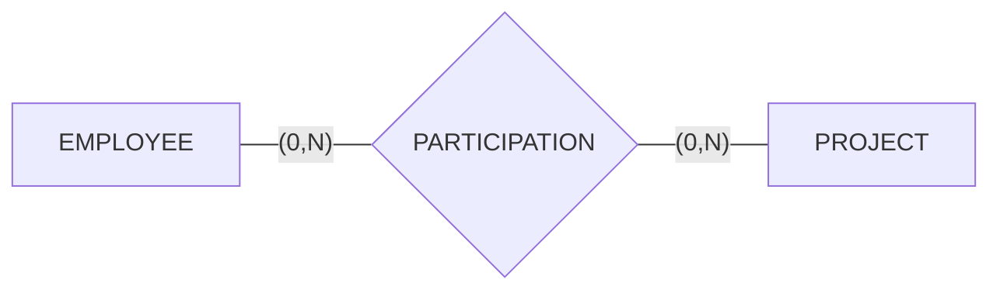
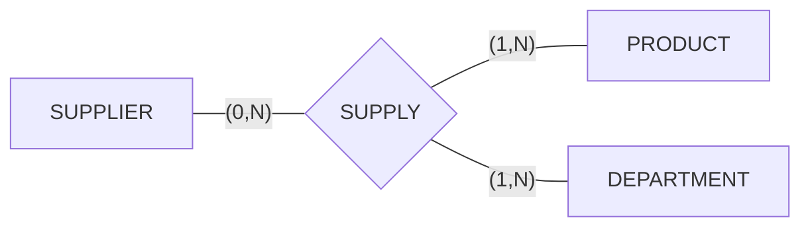
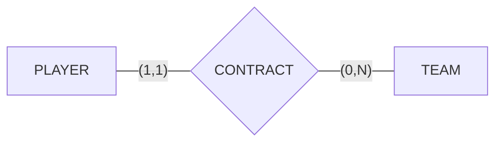
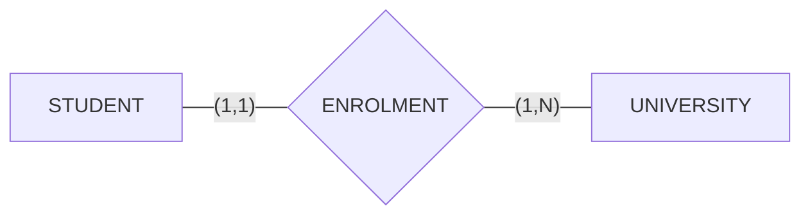
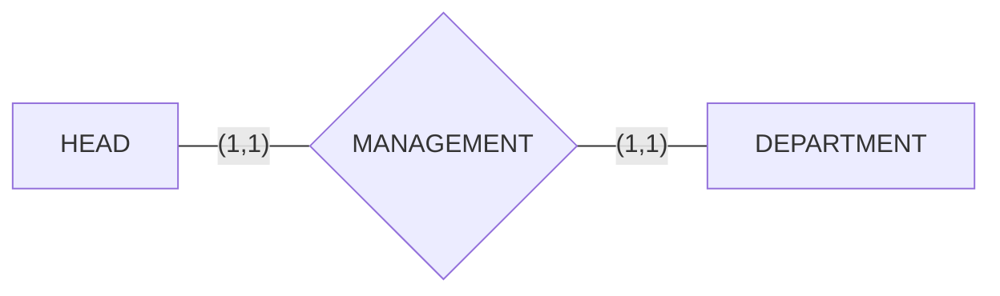
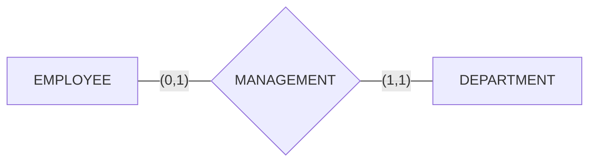
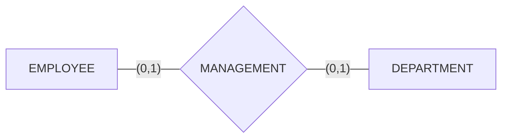

# Lesson 14: Logical Design Part 2, Translating an ER Schema into Tables

[← Previous: Logical design, restructuring](13-logical-design-restructuring.md) · [Back to index](../README.md) · [Next: Design theory and normalisation →](15-design-theory-and-normalisation.md)

## The big idea

[Lesson 13](13-logical-design-restructuring.md) reshaped the ER schema so it contains nothing the relational model can't handle: no generalisations, no multi-valued attributes. This lesson finishes logical design. The restructured ER schema is **translated** into an equivalent **relational schema**: a set of tables that represents the **same information** as the ER schema.

Two rules cover almost everything:

- **Entities are easy.** Each entity becomes a relation. Its attributes become columns, and its identifier becomes the primary key.
- **Relationships need thought.** How a relationship is translated depends on its **cardinalities**: many-to-many, one-to-many or one-to-one.

> **Analogy:** moving house. The furniture (entities) goes straight into rooms. The tricky part is the things that connect rooms: a shared bookshelf between two bedrooms has to be put **somewhere**. Whether it goes in one room, the other, or a hallway of its own depends on how it is used. Relationships are the same: the cardinalities tell you where the link should live.

## Notation in this lesson

The lecture writes relational schemas like this, with the **primary key underlined**:

**EMPLOYEE** (<ins>Number</ins>, FirstName, Surname, Salary)

When the key has several attributes, each one is underlined:

**PARTICIPATION** (<ins>Employee</ins>, <ins>Project</ins>, StartDate)

## The decision at a glance



## 1. Many-to-many relationships



- EMPLOYEE: Number (identifier), FirstName, Surname, Salary
- PROJECT: Code (identifier), Name, Budget
- PARTICIPATION has the attribute StartDate

**Relational schema:**

**EMPLOYEE** (<ins>Number</ins>, FirstName, Surname, Salary)
**PROJECT** (<ins>Code</ins>, Name, Budget)
**PARTICIPATION** (<ins>Employee</ins>, <ins>Project</ins>, StartDate)

### The rules

1. **Each entity** is translated into a relation.
2. **The relationship** is translated into its own relation, called an **associative table**.
3. Its **key is composite**: it is made of the keys of the two entities involved.
4. **Foreign keys** are added to maintain referential integrity: Employee references EMPLOYEE(Number), and Project references PROJECT(Code).
5. The attributes of the relationship (StartDate) become ordinary columns of the associative table.

**Renaming.** In PARTICIPATION, the attributes that refer to Number and Code are **renamed to more meaningful names**: Employee and Project. A column called "Number" in a table about participation would be unclear.

### Why a separate table?

One employee works on many projects, and one project has many employees. Neither table can hold the link:

- A single "Project" column in EMPLOYEE can't hold several projects. That would be a multi-valued attribute.
- A single "Employee" column in PROJECT can't hold several employees either.

The only place for many-to-many pairs is a table of their own, with **one row per pair**.

| Employee | Project | StartDate |
|---|---|---|
| 101 | P1 | 2026-01-10 |
| 101 | P2 | 2026-03-02 |
| 104 | P1 | 2026-02-15 |

Employee 101 works on two projects. Project P1 has two employees.

**Why that key?** The pair (Employee, Project) identifies a row: an employee joins a given project once. Neither column alone is enough, because both repeat.

### Ternary relationships

The same rule works for a relationship between **three** entities.



**SUPPLIER** (<ins>SupplierID</ins>, SupplierName)
**PRODUCT** (<ins>Code</ins>, Name, Type)
**DEPARTMENT** (<ins>Name</ins>, Telephone)
**SUPPLY** (<ins>Supplier</ins>, <ins>Product</ins>, <ins>Department</ins>, Quantity)

The key of SUPPLY is made of the keys of **all three** entities, and each part is a foreign key to its own table.

### Writing it in SQL

**Beyond the notes:** this is how the PARTICIPATION table looks as a `create table`, using the syntax from [Lesson 6](06-sql-constraints-and-schema-updates.md).

```sql
create table PARTICIPATION(
    Employee integer,
    Project varchar(10),
    StartDate date,
    primary key (Employee, Project),
    foreign key (Employee)
        references EMPLOYEE(Number),
    foreign key (Project)
        references PROJECT(Code)
)
```

## 2. One-to-many relationships



- PLAYER: Surname + DateOfBirth (identifier together), Position
- TEAM: Name (identifier), Town, TeamColours
- CONTRACT has the attribute Salary

A player has exactly one contract with one team. A team has any number of players.

The lecture gives **two** solutions.

### Solution 1: a separate relation

**PLAYER** (<ins>Surname</ins>, <ins>DateOfBirth</ins>, Position)
**TEAM** (<ins>Name</ins>, Town, TeamColours)
**CONTRACT** (<ins>PlayerSurname</ins>, <ins>PlayerDayOfBirth</ins>, Team, Salary)

- The relationship becomes a relation, as for many-to-many.
- But its key is **not** the combination of both keys. It is **the key of the entity with maximum cardinality 1**, which is PLAYER.

**Why?** Each player appears in CONTRACT **at most once**, because a player has only one contract. So the player alone already identifies a row. Team is an ordinary column, and a foreign key to TEAM.

### Solution 2: add attributes to the max-1 side

**PLAYER** (<ins>Surname</ins>, <ins>DateOfBirth</ins>, Position, Team, Salary)
**TEAM** (<ins>Name</ins>, Town, TeamColours)

- No separate relation. The relationship is translated into **attributes within the relation that has maximum cardinality 1**, which is PLAYER.
- The new attributes are the **key of the other entity** (Team, a foreign key to TEAM) and the **relationship's own attributes** (Salary).

### Which one is more natural?

Solution 2 uses one fewer table and needs no join to find a player's team. With a minimum cardinality of **1** on the PLAYER side, every player has a contract, so Team and Salary are never null.

⚠️ **Always put the columns on the max-1 side.** Putting a "Player" column in TEAM would not work, because a team has many players and a single column can't hold them all. (That would be a multi-valued attribute again.)

### One-to-many with an external identifier



- STUDENT is identified by StudentID **together with UNIVERSITY** (an external identifier, as in [Lesson 11](11-entity-relationship-model.md#external-identifiers)). It also has Surname, and ENROLMENT has EnrolmentYear.
- UNIVERSITY: Name (identifier), Town, Address

**UNIVERSITY** (<ins>Name</ins>, Town, Address)
**STUDENT** (<ins>StudentID</ins>, <ins>University</ins>, Surname, EnrolmentYear)

- The entity with an **external identifier** is translated into a relation with a **composite key**: its own identifying attribute plus the key of the entity it depends on.
- The relationship is translated into attributes of STUDENT, the side with maximum cardinality 1. University does two jobs here: it is part of the key **and** a foreign key to UNIVERSITY.

✅ An external identifier always becomes **part of the primary key** in the relational schema.

## 3. One-to-one relationships

Here **both** maximum cardinalities are 1, so the link could go on either side. The **minimum** cardinalities decide which choice is best.

### Case A: both participations mandatory, (1,1) and (1,1)



- HEAD: Number (identifier), Name, Salary
- DEPARTMENT: Name (identifier), Telephone, Branch
- MANAGEMENT has the attribute StartDate

Every head manages exactly one department, and every department has exactly one head. The lecture gives **four** solutions, all valid.

| Solution | Relational schema | Where the link goes |
|---|---|---|
| 1 | **HEAD** (<ins>Number</ins>, Name, Salary, Department, StartDate)<br/>**DEPARTMENT** (<ins>Name</ins>, Telephone, Branch) | columns in HEAD |
| 2 | **HEAD** (<ins>Number</ins>, Name, Salary)<br/>**DEPARTMENT** (<ins>Name</ins>, Telephone, Branch, Head, StartDate) | columns in DEPARTMENT |
| 3 | **HEAD** (<ins>Number</ins>, Name, Salary)<br/>**DEPARTMENT** (<ins>Name</ins>, Telephone, Branch)<br/>**MANAGEMENT** (<ins>Head</ins>, Department, StartDate) | separate relation, keyed on Head |
| 4 | **HEAD** (<ins>Number</ins>, Name, Salary)<br/>**DEPARTMENT** (<ins>Name</ins>, Telephone, Branch)<br/>**MANAGEMENT** (Head, <ins>Department</ins>, StartDate) | separate relation, keyed on Department |

**Why can MANAGEMENT be keyed on either column?** Each head appears in MANAGEMENT once, and so does each department. So **both** Head and Department identify a row. Both are candidate keys, and either can be chosen as the primary key.

Since both sides are mandatory, solutions 1 and 2 never need null values, and they avoid an extra table.

### Case B: one participation optional, (0,1) and (1,1)



Now the first entity is EMPLOYEE, not HEAD. Most employees manage nothing: participation is **optional** on the EMPLOYEE side. Every department still has exactly one manager.

| Solution | Relational schema | |
|---|---|---|
| 1 | **EMPLOYEE** (<ins>Number</ins>, Name, Salary, Department, StartDate)<br/>**DEPARTMENT** (<ins>Name</ins>, Telephone, Branch) | ❌ Department and StartDate are **sparse** |
| 2 | **EMPLOYEE** (<ins>Number</ins>, Name, Salary)<br/>**DEPARTMENT** (<ins>Name</ins>, Telephone, Branch, Head, StartDate) | ✅ **preferred translation** |

**Why solution 2?** In solution 1, every employee who isn't a manager has **null** in Department and StartDate. With hundreds of employees and a handful of departments, those columns are almost entirely null. The lecture calls these **sparse attributes** (lots of null values).

In solution 2, the link sits on the DEPARTMENT side, where participation is **mandatory**. Every department has a head, so Head and StartDate always have a value.

✅ **Rule:** for a one-to-one relationship with one optional side, put the link columns in the table of the entity whose participation is **mandatory**.

### Case C: both participations optional, (0,1) and (0,1)



Now a department may also be without a manager. Whichever table the link columns go in, some rows will have nulls.

| Solution | Relational schema | |
|---|---|---|
| 3 | **EMPLOYEE** (<ins>Number</ins>, Name, Salary)<br/>**DEPARTMENT** (<ins>Name</ins>, Telephone, Branch)<br/>**MANAGEMENT** (<ins>Head</ins>, Department, StartDate) | ✅ preferred |
| 4 | **EMPLOYEE** (<ins>Number</ins>, Name, Salary)<br/>**DEPARTMENT** (<ins>Name</ins>, Telephone, Branch)<br/>**MANAGEMENT** (Head, <ins>Department</ins>, StartDate) | ✅ preferred |

**Why a separate relation?** MANAGEMENT only contains rows for links that **actually exist**. An employee who manages nothing, or a department with no manager, simply has no row in it, so no nulls are needed anywhere.

As in case A, Head and Department are both candidate keys of MANAGEMENT, so either can be the primary key.

## 4. Summary of the translation rules

| Relationship | Minimums | Translation |
|---|---|---|
| Many-to-many | any | new relation. Key = keys of **all** the entities involved |
| One-to-many | any | attributes in the relation on the **max-1 side** (solution 2), or a new relation keyed on the max-1 side's key (solution 1) |
| One-to-one | both mandatory | attributes in **either** relation, or a new relation |
| One-to-one | one optional | attributes in the relation on the **mandatory** side ✅ |
| One-to-one | both optional | a **new relation** ✅ |

Every time:
- Foreign keys are introduced to maintain referential integrity.
- Attributes are renamed to meaningful names where needed.
- An external identifier becomes part of a composite primary key.

## Step-by-step method

To translate a whole ER schema:

1. **Translate every entity** into a relation. Attributes become columns, and the identifier becomes the primary key (underlined).
2. **Add external identifiers** to the keys of the entities that have them.
3. **Go through the relationships one by one.** For each, write down its two maximum cardinalities and classify it.
4. **Apply the rule for that type.** Decide whether it becomes a new relation or new columns.
5. **Mark the foreign keys**, and rename columns so their meaning is clear.
6. **Check** that no column needs to hold more than one value, and that you haven't created columns that are mostly null.

## What to remember

- Entities → relations. The identifier becomes the primary key.
- **Many-to-many → always a new relation**, with a composite key made of both entities' keys.
- **One-to-many → columns on the max-1 side**, or a new relation keyed on the max-1 side.
- **One-to-one → look at the minimums.** One optional side: put the link on the mandatory side. Both optional: a new relation.
- Avoid **sparse attributes** (columns that are mostly null).
- External identifiers become part of a **composite key**.
- Every link becomes a **foreign key**. Rename columns to make their meaning clear.

---

## Quiz

**Q1.** What is the main thing that decides how a relationship is translated?

<details><summary>Show answer</summary>

Its **cardinalities**: whether it is many-to-many, one-to-many or one-to-one (and, for one-to-one, which participations are optional).
</details>

**Q2.** STUDENT (StudentID) and MODULE (Code) are linked by a relationship TAKES with cardinalities (0,N) and (1,N), and TAKES has an attribute Grade. Write the relational schema.

<details><summary>Show answer</summary>

It is **many-to-many**, so TAKES becomes its own relation:

**STUDENT** (<ins>StudentID</ins>, …)
**MODULE** (<ins>Code</ins>, …)
**TAKES** (<ins>Student</ins>, <ins>Module</ins>, Grade)

Student is a foreign key to STUDENT and Module a foreign key to MODULE. The key is the pair.
</details>

**Q3.** Why can't a many-to-many relationship be translated by adding a column to one of the two entity tables?

<details><summary>Show answer</summary>

Each occurrence on either side can be linked to **many** occurrences on the other. A single column can hold only one value, so it couldn't record all the links. It would be a multi-valued attribute.
</details>

**Q4.** In the PLAYER / CONTRACT / TEAM example, solution 1, what is the key of CONTRACT, and why isn't Team part of it?

<details><summary>Show answer</summary>

The key is **(PlayerSurname, PlayerDayOfBirth)**, the key of PLAYER. PLAYER has maximum cardinality 1 in CONTRACT, so each player appears in CONTRACT at most once and identifies the row alone. Team is an ordinary attribute (and a foreign key).
</details>

**Q5.** EMPLOYEE (Number) and DEPARTMENT (Name) are linked by WORKS_IN with cardinalities (1,1) for EMPLOYEE and (0,N) for DEPARTMENT. Using solution 2, which table gets the new column, and what is it?

<details><summary>Show answer</summary>

**EMPLOYEE** gets a column **Department**, a foreign key to DEPARTMENT(Name). EMPLOYEE is the side with maximum cardinality 1.

**EMPLOYEE** (<ins>Number</ins>, …, Department)
**DEPARTMENT** (<ins>Name</ins>, …)
</details>

**Q6.** A student puts the link from Q5 in DEPARTMENT instead, as a column called Employee. What goes wrong?

<details><summary>Show answer</summary>

A department has **many** employees, but a single column can hold only one. The link must go on the max-1 side, which is EMPLOYEE.
</details>

**Q7.** STUDENT is identified externally by StudentID together with UNIVERSITY. What is the primary key of the STUDENT relation?

<details><summary>Show answer</summary>

**(StudentID, University)**. An entity with an external identifier is translated into a relation with a composite key, and University is also a foreign key to UNIVERSITY.
</details>

**Q8.** In the one-to-one MANAGEMENT example with (1,1) on both sides, why can the separate MANAGEMENT relation be keyed on Head **or** on Department?

<details><summary>Show answer</summary>

Each head appears in MANAGEMENT exactly once, and so does each department. So **both** attributes uniquely identify a row: both are candidate keys, and either can be chosen as the primary key.
</details>

**Q9.** EMPLOYEE takes part in MANAGEMENT with (0,1) and DEPARTMENT with (1,1). Which translation is preferred, and why?

<details><summary>Show answer</summary>

Put Head and StartDate in **DEPARTMENT**:

**EMPLOYEE** (<ins>Number</ins>, Name, Salary)
**DEPARTMENT** (<ins>Name</ins>, Telephone, Branch, Head, StartDate)

Every department has a manager, so the columns always have values. Putting them in EMPLOYEE instead would make them **sparse**: null for every employee who isn't a manager.
</details>

**Q10.** What are sparse attributes?

<details><summary>Show answer</summary>

Attributes with **lots of null values**.
</details>

**Q11.** A one-to-one relationship has (0,1) on both sides. What is the preferred translation?

<details><summary>Show answer</summary>

A **separate relation** for the relationship, keyed on either entity's key. It contains rows only for links that exist, so neither entity table needs null columns.
</details>

**Q12.** In the restructured training company schema ([Lesson 13](13-logical-design-restructuring.md#5-complete-example-the-training-company)), TEACHING links COURSE EDITION (1,1) and INSTRUCTOR (0,N). COURSE EDITION is identified by Code, and INSTRUCTOR by SSN. How would you translate TEACHING?

<details><summary>Show answer</summary>

It is **one-to-many**, and COURSE EDITION is the max-1 side. Add a column Instructor to COURSE EDITION:

**COURSE EDITION** (<ins>Code</ins>, StartDate, EndDate, Course, Instructor)

Instructor is a foreign key to INSTRUCTOR(SSN). (Course comes from TYPE, which is translated the same way.)
</details>

**Q13.** In the same schema, ATTENDANCE links TRAINEE (0,N) and COURSE EDITION (1,N), with an attribute Marks. TRAINEE is identified by Code. How would you translate it?

<details><summary>Show answer</summary>

It is **many-to-many**, so it becomes its own relation:

**ATTENDANCE** (<ins>Trainee</ins>, <ins>Edition</ins>, Marks)

Trainee references TRAINEE(Code) and Edition references COURSE EDITION(Code).
</details>

**Q14.** In the same schema, HOLDER links TELEPHONE (1,1) and INSTRUCTOR (1,N). TELEPHONE is identified by Number. How would you translate it?

<details><summary>Show answer</summary>

**One-to-many**, with TELEPHONE on the max-1 side:

**TELEPHONE** (<ins>Number</ins>, Instructor)

Instructor is a foreign key to INSTRUCTOR(SSN). This is how the multi-valued attribute Phone, removed during restructuring, ends up in the tables.
</details>
