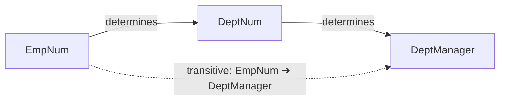

# Lesson 15: Design Theory and Normalisation

[← Previous: Logical design, translation](14-logical-design-translation.md) · [Back to index](../README.md)

## The big idea

Some table designs **work** but cause trouble: the same fact is stored over and over, deleting one row wipes out unrelated information, and joins invent rows that aren't true. **Normalisation** is a formal way to spot those designs and fix them, by splitting tables in the right places.

It rests on one idea, the **functional dependency**: "if you know X, you know Y". Each **normal form** (1NF, 2NF, 3NF) is a test that a table must pass, and each test has a remedy.

> **Analogy:** a school keeps one big spreadsheet with a row per student per class, and on every row it types the teacher's name and phone number. When a teacher changes phone, someone has to fix dozens of rows, and will miss some. The obvious fix is a separate list of teachers, with each phone number written once. Normalisation is that fix, made systematic.

## 1. Bad design 1: redundant information

**EMP_DEPT** (<ins>EmpNum</ins>, Name, DeptNum, DeptName, DeptManager)

| EmpNum | Name | DeptNum | DeptName | DeptManager |
|---|---|---|---|---|
| 7499 | Andrei | 30 | Surveying | 7499 |
| 7521 | Bianchi | 30 | Surveying | 7499 |
| 7654 | Martini | 30 | Surveying | 7499 |
| 7788 | Scotti | 20 | R&D | 7788 |

The fact "department 30 is Surveying, managed by 7499" is stored **three times**, once per employee. That repetition causes three kinds of **anomaly**.

| Anomaly | The problem | In this table |
|---|---|---|
| **Insertion** | adding data is awkward or impossible | every new employee needs the department details typed correctly. If someone types "Survey" by mistake, the data becomes inconsistent. And a **new department with no employees** can't be added at all, because every row needs an EmpNum, the key |
| **Deletion** | deleting one fact destroys another | Scotti is the only employee in R&D. Deleting Scotti's row **removes all information about R&D** |
| **Modification** | changing one fact means changing many rows | to change the manager of Surveying, **every** Surveying row must be updated. Miss one and the table disagrees with itself |

## 2. Bad design 2: wide tables and null values

**EXAMS** (<ins>StudentID</ins>, COMP40725, COMP40610, COMP41400, COMP30110, …)

| StudentID | COMP40725 | COMP40610 | COMP41400 | COMP30110 | … |
|---|---|---|---|---|---|
| 276545 | null | null | A | null | … |
| 485745 | A | null | null | A+ | … |
| 200768 | B- | A | A | null | … |
| 587614 | A- | null | A | C | … |

One column per module. The problems:

- **The nulls take up storage space**, and they have **different meanings**: not taken the module, not graded yet, or failed to sit it? The table can't say.
- **Many queries are difficult to write.** Try these:
  - Find all grades for any module whose code starts with 'COMP4'.
  - Find all pairs of students who received an A in the same module.

  Module codes are **column names**, not data, so `like 'COMP4%'` can't be used on them, and every query must list the columns one by one.

**The fix** is one row per student per module: **EXAMS** (<ins>StudentID</ins>, <ins>Module</ins>, Grade). Then the first query is just `where Module like 'COMP4%'`.

## 3. Bad design 3: spurious tuples

A **spurious tuple** is a row produced by a join that **does not represent a real fact**.

**EMPLOYEES** (<ins>EmpNum</ins>, Name, DeptManager)
**DEPARTMENTS** (<ins>DeptNum</ins>, DeptName, DeptManager)

| EmpNum | Name | DeptManager |
|---|---|---|
| 7499 | Andrei | 7499 |
| 7521 | Bianchi | 7499 |
| 7654 | Martini | 7499 |
| 7788 | Scotti | 7788 |

| DeptNum | DeptName | DeptManager |
|---|---|---|
| 30 | Surveying | 7499 |
| 20 | R&D | 7788 |
| 10 | Engineering | 7788 |

Employees are linked to departments only through the **manager**. To find each employee's department, join on DeptManager:

```sql
select *
from EMPLOYEES E
join DEPARTMENTS D on E.DeptManager = D.DeptManager
```

| EmpNum | Name | DeptManager | DeptNum | DeptName |
|---|---|---|---|---|
| 7499 | Andrei | 7499 | 30 | Surveying |
| 7521 | Bianchi | 7499 | 30 | Surveying |
| 7654 | Martini | 7499 | 30 | Surveying |
| 7788 | Scotti | 7788 | 20 | R&D |
| 7788 | Scotti | 7788 | **10** | **Engineering** ← spurious |

Manager 7788 manages **two** departments, so the join pairs Scotti with both. Scotti actually works only in R&D. The last row is **false information created by the join**.

**Why it happens:** the join is on an attribute (DeptManager) that is **not a key** of DEPARTMENTS. One manager value matches several departments. The link between the tables was chosen badly. The fix is to store the department number in EMPLOYEES and join on DeptNum, the key.

## 4. Four informal guidelines

To avoid bad designs:

1. Make sure the **semantics** (meaning) of attributes is **clear**.
2. **Reduce redundant information** in tuples.
3. **Reduce null values** in tuples.
4. **Disallow the possibility of generating spurious tuples.**

| Guideline | The bad design it prevents |
|---|---|
| 2 | redundant information (EMP_DEPT) |
| 3 | wide tables full of nulls (EXAMS) |
| 4 | spurious tuples (the DeptManager join) |

## 5. Normalisation and normal forms

**Normalisation** provides database designers with:

- a **formal framework** for analysing relation schemas based on their **keys** and on the **functional dependencies** (FDs) among their attributes, and
- a series of **normal form tests** that can be carried out on individual relation schemas, so the database can be normalised to a desired degree.

The ultimate goals are:

- **minimising redundancy**, and
- **minimising update anomalies** (insertion, deletion and modification).

### Keys: a recap

- A relation can have several **candidate keys**: groups of attributes that uniquely identify its tuples.
- The **primary key** (PK) is the candidate key that is selected.
- In a practical relational database, **every relation must have a PK**.
- An attribute is a **prime attribute** of relation R if it is a **member of a candidate key** of R. All other attributes are **non-key** (non-prime) attributes.

**Example:** in EXAMS (<ins>StudentID</ins>, <ins>CourseID</ins>, Grade, CourseName), StudentID and CourseID are prime attributes. Grade and CourseName are non-key attributes.

## 6. Functional dependencies

Let X and Y be two sets of attributes of a relation R. A **functional dependency** X ➔ Y says:

> For any two tuples t<sub>1</sub> and t<sub>2</sub> in R, **if t<sub>1</sub>[X] = t<sub>2</sub>[X], then t<sub>1</sub>[Y] = t<sub>2</sub>[Y]**.

In words: **whenever two rows agree on X, they must also agree on Y**. We say X **functionally determines** Y. If you know the value of X, there is only one possible value of Y.

**Examples in EMP_DEPT:**

- **FD1: EmpNum ➔ {Name, DeptNum}.** Knowing the employee number tells you their name and department.
- **FD2: DeptNum ➔ {DeptName, DeptManager}.** Knowing the department number tells you its name and manager.

Check FD2 against the data: the three rows with DeptNum 30 all have DeptName Surveying and DeptManager 7499. They agree on X, so they agree on Y. ✅

### How to tell whether an FD holds

Ask: **could two rows have the same X but a different Y?**

| Claim | Holds? | Reason |
|---|---|---|
| DeptNum ➔ DeptName | ✅ | a department has one name |
| DeptName ➔ DeptNum | ✅ here | assuming department names are unique |
| DeptNum ➔ EmpNum | ❌ | department 30 has three employees |
| Name ➔ EmpNum | ❌ in general | two employees can share a name |

⚠️ An FD is a rule about **what the data means**, not just about the rows you can see. A handful of rows can't prove an FD. They can only disprove one.

### Transitive dependency

An FD **X ➔ Y** in relation R is a **transitive dependency** if there is a set of attributes **Z** in R such that:

- Z is **not a candidate key, nor a subset of any key** of R, and
- **both X ➔ Z and Z ➔ Y hold.**

In other words, X determines Y only **indirectly**, by going through a non-key "middle" attribute Z.

**Example:** in EMP_DEPT, **EmpNum ➔ DeptManager** is transitive through **DeptNum**, which is a non-key attribute:

- EmpNum ➔ DeptNum (an employee is in one department), and
- DeptNum ➔ DeptManager (a department has one manager).



## 7. The normal forms

Codd's first three normal forms are tests applied **in order**. A relation in 3NF is also in 2NF and 1NF.

| Normal form | Test | Remedy |
|---|---|---|
| **1NF** | the relation has **no multi-valued attributes** or nested relations | form a **new relation for each** multi-valued attribute or nested relation |
| **2NF** | for relations whose PK has **several attributes**: no non-key attribute is functionally dependent on **part** of the primary key | **decompose**: set up a new relation for each partial key with its dependent attributes. Keep a relation with the original PK and the attributes **fully** dependent on it |
| **3NF** | no non-key attribute is functionally determined by **another non-key attribute** (or set of them). There is **no transitive dependency** of a non-key attribute on the PK | **decompose**: set up a relation that includes the non-key attribute(s) that determine other non-key attributes |

A short way to remember all three (**beyond the notes**, a common summary): every non-key attribute must depend on **the key** (1NF), **the whole key** (2NF), **and nothing but the key** (3NF).

### First normal form (1NF)

**Violation:** a multi-valued attribute.

**DEPARTMENTS** (<ins>DeptNum</ins>, DeptName, Offices)

| DeptNum | DeptName | Offices |
|---|---|---|
| 10 | Engineering | B106, B107 |
| 20 | R&D | B107, A25 |
| 30 | Surveying | A25 |

The Offices cell holds **several values**.

**After normalisation:**

**DEPARTMENTS** (<ins>DeptNum</ins>, DeptName)
**OFFICES** (<ins>DeptNum</ins>, <ins>Office</ins>)

| DeptNum | DeptName |
|---|---|
| 10 | Engineering |
| 20 | R&D |
| 30 | Surveying |

| DeptNum | Office |
|---|---|
| 10 | B106 |
| 10 | B107 |
| 20 | B107 |
| 20 | A25 |
| 30 | A25 |

The new relation has **one row per value**. Its key is the pair (DeptNum, Office), because a department has several offices and an office can be shared by several departments.

This is the same fix as removing a multi-valued attribute during restructuring ([Lesson 13](13-logical-design-restructuring.md#removing-a-multi-valued-attribute)).

### Second normal form (2NF)

**Violation:** a **partial dependency**, where a non-key attribute depends on only part of a composite primary key.

**EXAMS** (<ins>StudentID</ins>, <ins>CourseID</ins>, Grade, CourseName)

| StudentID | CourseID | Grade | CourseName |
|---|---|---|---|
| 276545 | 01 | C | Physics |
| 485745 | 01 | A+ | Physics |
| 200768 | 01 | A- | Physics |
| 587614 | 03 | B- | Chemistry |

The FDs are:

- {StudentID, CourseID} ➔ Grade. A grade needs **both**: which student, and which course. ✅ fully dependent.
- **CourseID ➔ CourseName.** The course name depends on CourseID **only**, not on the student. ❌ partial dependency.

So "course 01 is Physics" is repeated for every student who took it.

**After normalisation:**

**COURSES** (<ins>CourseID</ins>, CourseName)
**EXAMS** (<ins>StudentID</ins>, <ins>CourseID</ins>, Grade)

| CourseID | CourseName |
|---|---|
| 01 | Physics |
| 03 | Chemistry |

| StudentID | CourseID | Grade |
|---|---|---|
| 276545 | 01 | C |
| 485745 | 01 | A+ |
| 200768 | 01 | A- |
| 587614 | 03 | B- |

The partial key (CourseID) and the attribute that depends on it (CourseName) moved to a new relation. EXAMS keeps the original PK and Grade, which depends on the whole key. CourseID in EXAMS is now a foreign key to COURSES.

✅ **A relation whose primary key has a single attribute can't violate 2NF.** There is no "part" of the key to depend on. The 2NF test only applies to composite keys.

### Third normal form (3NF)

**Violation:** a **transitive dependency**, where a non-key attribute depends on another non-key attribute.

**EMP_DEPT** (<ins>EmpNum</ins>, Name, DeptNum, DeptName, DeptManager)

The key is a single attribute, so EMP_DEPT is in 2NF. But:

- EmpNum ➔ DeptNum, and DeptNum ➔ {DeptName, DeptManager}
- so **EmpNum ➔ DeptName** and **EmpNum ➔ DeptManager** are both **transitive through DeptNum**, a non-key attribute.

That transitive dependency is exactly what caused the anomalies in section 1.

**After normalisation:**

**EMPLOYEES** (<ins>EmpNum</ins>, Name, DeptNum)
**DEPARTMENTS** (<ins>DeptNum</ins>, DeptName, DeptManager)

| EmpNum | Name | DeptNum |
|---|---|---|
| 7499 | Andrei | 30 |
| 7521 | Bianchi | 30 |
| 7654 | Martini | 30 |
| 7788 | Scotti | 20 |

| DeptNum | DeptName | DeptManager |
|---|---|---|
| 30 | Surveying | 7499 |
| 20 | R&D | 7788 |

DeptNum, the non-key attribute that determined the others, becomes the **key of a new relation** along with the attributes it determines. It stays in EMPLOYEES as a foreign key.

**The anomalies are gone:**

| Anomaly | Now |
|---|---|
| Insertion | a new department can be added to DEPARTMENTS with no employees |
| Deletion | deleting Scotti leaves R&D in DEPARTMENTS |
| Modification | changing Surveying's manager is a change to **one** row |

## 8. How to normalise a relation, step by step

1. **Find the primary key.**
2. **List the functional dependencies.** For each non-key attribute, ask: "what do I need to know to determine this?"
3. **1NF:** is any attribute multi-valued? If so, move it into a new relation (the key plus that attribute).
4. **2NF:** only if the key has several attributes. Does any non-key attribute depend on **part** of the key? If so, move that part and its dependent attributes into a new relation.
5. **3NF:** does any non-key attribute depend on **another non-key attribute**? If so, move the determining attribute and the attributes it determines into a new relation. The determining attribute is its key.
6. **Check:** every new relation has a primary key, and the original relation keeps the attribute that links to each new one, as a **foreign key**.

### Worked example

**ORDERS** (<ins>OrderNum</ins>, <ins>ProductCode</ins>, Quantity, ProductName, CustomerID, CustomerName)

FDs:
- {OrderNum, ProductCode} ➔ Quantity
- ProductCode ➔ ProductName
- OrderNum ➔ CustomerID
- CustomerID ➔ CustomerName

| Step | Finding | Action |
|---|---|---|
| 1NF | no multi-valued attributes | ✅ already 1NF |
| 2NF | ProductName depends on ProductCode only. CustomerID and CustomerName depend on OrderNum only | split out **PRODUCTS** (<ins>ProductCode</ins>, ProductName) and **ORDERS** (<ins>OrderNum</ins>, CustomerID, CustomerName). Keep **ORDER_LINES** (<ins>OrderNum</ins>, <ins>ProductCode</ins>, Quantity) |
| 3NF | in the new ORDERS: OrderNum ➔ CustomerID ➔ CustomerName, a transitive dependency | split out **CUSTOMERS** (<ins>CustomerID</ins>, CustomerName). ORDERS becomes (<ins>OrderNum</ins>, CustomerID) |

**Final schema:**

**ORDER_LINES** (<ins>OrderNum</ins>, <ins>ProductCode</ins>, Quantity)
**PRODUCTS** (<ins>ProductCode</ins>, ProductName)
**ORDERS** (<ins>OrderNum</ins>, CustomerID)
**CUSTOMERS** (<ins>CustomerID</ins>, CustomerName)

(This example is not from the slides. It applies the lecture's tests to a new case.)

## 9. Other normal forms

- 1NF, 2NF and 3NF were proposed by **Ted Codd in 1972**, as a sequence of tests to reach the desirable state of 3NF relations.
- **Higher normal forms exist**: Boyce-Codd NF, 4NF, 5NF.
- Normalisation **up to 3NF, or at most 4NF**, is current standard practice.
- Designers **may leave relations in a lower normal form** (for example 2NF) for specific reasons, such as the performance of particular queries. In that case the **anomalies must be properly handled**.

The last point connects to [Lesson 13](13-logical-design-restructuring.md#1-analysis-of-redundancies): a redundancy can be kept deliberately, but only if it is justified and kept consistent.

## What to remember

- Bad designs cause **insertion, deletion and modification anomalies**, wasted space on **nulls**, and **spurious tuples** in joins.
- Four guidelines: **clear semantics, less redundancy, fewer nulls, no spurious tuples**.
- **X ➔ Y**: whenever two rows agree on X, they agree on Y.
- **Transitive dependency**: X ➔ Z ➔ Y, where Z is not a key.
- A **prime attribute** belongs to a candidate key.
- **1NF**: no multi-valued attributes.
- **2NF**: no non-key attribute depends on **part** of a composite key. (A single-attribute key can't violate it.)
- **3NF**: no non-key attribute depends on another **non-key** attribute.
- The remedy is always to **decompose**: move the determining attribute and its dependants into a new relation, and leave a foreign key behind.
- Goals: **minimise redundancy** and **minimise update anomalies**.

---

## Quiz

**Q1.** Name the three kinds of update anomaly.

<details><summary>Show answer</summary>

**Insertion**, **deletion** and **modification** anomalies.
</details>

**Q2.** In EMP_DEPT, why can't a new department with no employees be added?

<details><summary>Show answer</summary>

Every tuple needs a value for **EmpNum**, the primary key, and a key can't be null. With no employee, there is no row in which to record the department. That is an **insertion anomaly**.
</details>

**Q3.** In EMP_DEPT, what happens if Scotti's row is deleted?

<details><summary>Show answer</summary>

**All information about the R&D department is lost**, because Scotti is its only employee. That is a **deletion anomaly**.
</details>

**Q4.** What is a spurious tuple, and what caused it in the EMPLOYEES / DEPARTMENTS example?

<details><summary>Show answer</summary>

A row produced by a join that **does not represent a real fact**. The join was on DeptManager, which is **not a key** of DEPARTMENTS. Manager 7788 manages two departments, so Scotti was paired with both R&D and Engineering, but Scotti works only in R&D.
</details>

**Q5.** List the four informal guidelines for avoiding bad schema designs.

<details><summary>Show answer</summary>

1. Make sure the **semantics of attributes is clear**.
2. **Reduce redundant information** in tuples.
3. **Reduce null values** in tuples.
4. **Disallow the possibility of generating spurious tuples.**
</details>

**Q6.** What are the two ultimate goals of normalisation?

<details><summary>Show answer</summary>

**Minimising redundancy** and **minimising update anomalies** (insertion, deletion and modification).
</details>

**Q7.** State the definition of the functional dependency X ➔ Y.

<details><summary>Show answer</summary>

For any pair of tuples t<sub>1</sub> and t<sub>2</sub> in R that have **t<sub>1</sub>[X] = t<sub>2</sub>[X]**, they must also have **t<sub>1</sub>[Y] = t<sub>2</sub>[Y]**. The values of X uniquely determine the values of Y.
</details>

**Q8.** In EMP_DEPT, does DeptNum ➔ Name hold? Why or why not?

<details><summary>Show answer</summary>

**No.** Three rows have DeptNum 30 but different names (Andrei, Bianchi, Martini). They agree on X but not on Y.
</details>

**Q9.** What is a prime attribute?

<details><summary>Show answer</summary>

An attribute that is a **member of a candidate key** of the relation.
</details>

**Q10.** Explain why EmpNum ➔ DeptManager is a transitive dependency in EMP_DEPT.

<details><summary>Show answer</summary>

EmpNum ➔ DeptNum and DeptNum ➔ DeptManager both hold, and DeptNum is **not a candidate key nor part of one**. So EmpNum determines DeptManager only **through** the non-key attribute DeptNum.
</details>

**Q11.** STUDENTS (<ins>StudentID</ins>, Name, Phones), where a student can have several phone numbers in the Phones attribute. Which normal form does it violate, and how is it fixed?

<details><summary>Show answer</summary>

It violates **1NF**, because Phones is multi-valued. Form a new relation for it:

**STUDENTS** (<ins>StudentID</ins>, Name)
**PHONES** (<ins>StudentID</ins>, <ins>Phone</ins>)
</details>

**Q12.** EXAMS (<ins>StudentID</ins>, <ins>CourseID</ins>, Grade, CourseName). Which attribute causes a 2NF violation, and why?

<details><summary>Show answer</summary>

**CourseName.** It is a non-key attribute that depends on **CourseID only**, which is just part of the primary key {StudentID, CourseID}.
</details>

**Q13.** True or false: a relation in 1NF whose primary key is a single attribute is automatically in 2NF.

<details><summary>Show answer</summary>

**True.** 2NF forbids a non-key attribute depending on **part** of the primary key. A single-attribute key has no proper part, so the test can't fail.
</details>

**Q14.** BOOKS (<ins>ISBN</ins>, Title, PublisherID, PublisherName). Each book has one publisher, and PublisherID ➔ PublisherName. What normal form is it in, and how is it fixed?

<details><summary>Show answer</summary>

It is in **2NF but not 3NF**. The key is a single attribute, so 2NF holds. But PublisherName depends on PublisherID, a **non-key** attribute: ISBN ➔ PublisherID ➔ PublisherName is transitive.

Fix:

**BOOKS** (<ins>ISBN</ins>, Title, PublisherID)
**PUBLISHERS** (<ins>PublisherID</ins>, PublisherName)
</details>

**Q15.** ENROLMENT (<ins>StudentID</ins>, <ins>ModuleCode</ins>, Mark, ModuleTitle, LecturerID, LecturerName). The FDs are: {StudentID, ModuleCode} ➔ Mark, ModuleCode ➔ {ModuleTitle, LecturerID}, LecturerID ➔ LecturerName. Normalise it to 3NF.

<details><summary>Show answer</summary>

**2NF:** ModuleTitle and LecturerID (and through them LecturerName) depend only on ModuleCode, part of the key. Split them out:

- ENROLMENT (<ins>StudentID</ins>, <ins>ModuleCode</ins>, Mark)
- MODULES (<ins>ModuleCode</ins>, ModuleTitle, LecturerID, LecturerName)

**3NF:** in MODULES, ModuleCode ➔ LecturerID ➔ LecturerName is transitive. Split it out:

- MODULES (<ins>ModuleCode</ins>, ModuleTitle, LecturerID)
- LECTURERS (<ins>LecturerID</ins>, LecturerName)

**Final:** ENROLMENT (<ins>StudentID</ins>, <ins>ModuleCode</ins>, Mark), MODULES (<ins>ModuleCode</ins>, ModuleTitle, LecturerID), LECTURERS (<ins>LecturerID</ins>, LecturerName).
</details>

**Q16.** Why might a designer deliberately leave a relation in 2NF instead of 3NF, and what must they then do?

<details><summary>Show answer</summary>

For a specific reason such as the **performance of particular queries** (avoiding a join, for example). The **anomalies must then be properly handled**, so the redundant data stays consistent.
</details>
